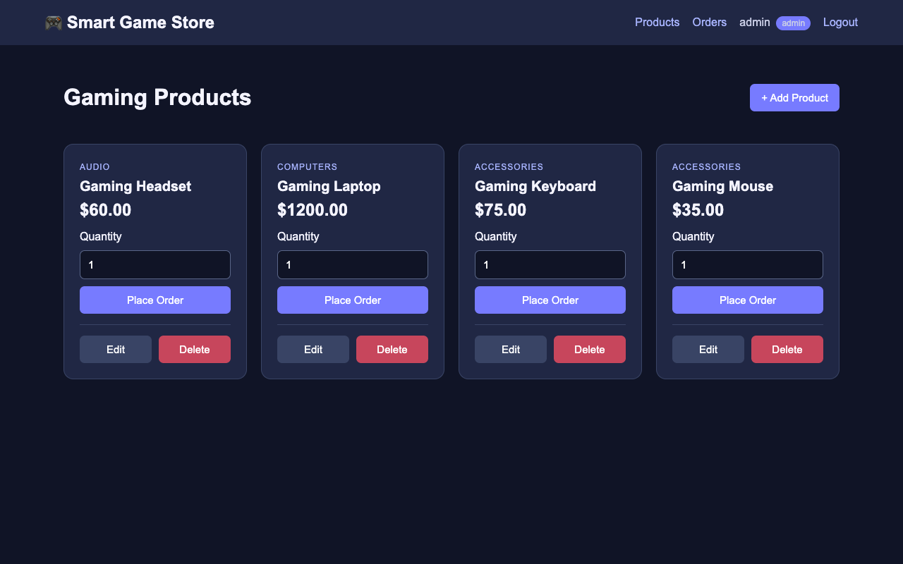
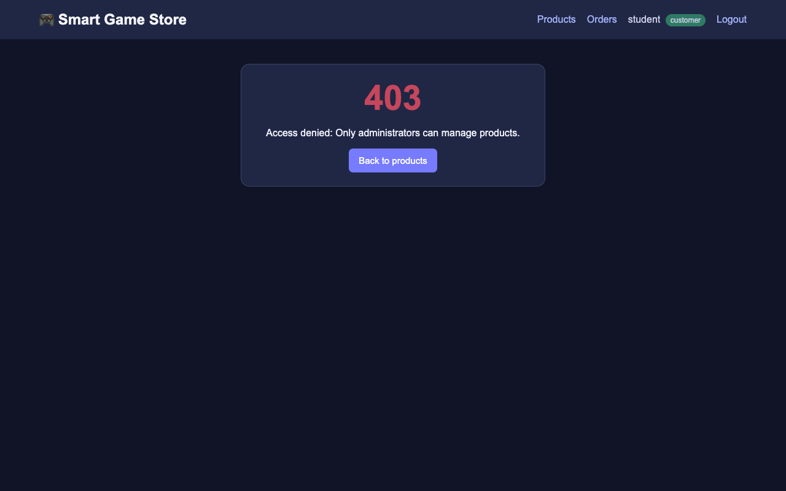

# Лабораторная работа: Smart Game Store — структурные паттерны проектирования

**Технологии:** Python 3, Flask, SQLite, HTML, CSS
**Паттерны:** Facade (Фасад), Proxy (Заместитель)

---

## 1. О проекте

Smart Game Store — веб-приложение интернет-магазина игровой техники: ноутбуки, клавиатуры,
мыши, гарнитуры. В приложении две роли:

| Роль | Логин / пароль | Что может |
|---|---|---|
| Администратор | `admin` / `admin123` | смотреть, добавлять, редактировать и удалять товары; видеть **все** заказы; оформлять заказы |
| Покупатель | `student` / `student123` | смотреть товары, оформлять заказы, видеть **только свои** заказы |

## 2. Структура проекта

```
3/
├── README.md           этот отчёт
├── app.py              Flask-приложение: маршруты (routes), вход, обработка ошибок
├── patterns.py         паттерны Proxy (ProductProxy) и Facade (OrderFacade)
├── database.py         подключение к SQLite, создание таблиц, демо-товары
├── store.db            база данных SQLite (создаётся автоматически)
├── requirements.txt    зависимости (Flask)
├── templates/
│   ├── base.html           общий шаблон страницы + страница входа
│   ├── products.html       каталог товаров
│   ├── product_form.html   форма добавления / редактирования товара
│   ├── orders.html         таблица заказов
│   └── error.html          страница ошибки 403 / 404
├── static/style.css    стили
└── screenshots/        скриншоты работы приложения
```

## 3. Как запустить

```bash
cd ~/Desktop/"Design Pattern/3"
python3 -m venv .venv                         # только в первый раз
.venv/bin/pip install -r requirements.txt     # только в первый раз
.venv/bin/python app.py
```

Открыть в браузере **http://127.0.0.1:5001**. Остановить сервер — `Ctrl + C`.

> Используется порт **5001**, а не 5000: на macOS порт 5000 занят системной службой
> AirPlay Receiver.

## 4. База данных

Файл `store.db` создаётся автоматически функцией `init_db()` из `database.py` при запуске.
Если таблица товаров пустая, в неё добавляются 4 демо-товара.

**products** — товары

| Колонка | Тип | Описание |
|---|---|---|
| id | INTEGER | первичный ключ, автоинкремент |
| name | TEXT | название, обязательно |
| category | TEXT | категория, обязательно |
| price | REAL | цена, обязательно, `CHECK(price >= 0)` |

**orders** — заказы

| Колонка | Тип | Описание |
|---|---|---|
| id | INTEGER | первичный ключ, автоинкремент |
| customer_name | TEXT | имя покупателя, обязательно |
| product_id | INTEGER | внешний ключ → `products(id)`, `ON DELETE RESTRICT` |
| quantity | INTEGER | количество, обязательно, `CHECK(quantity > 0)` |
| total_price | REAL | итоговая сумма, обязательно |

`ON DELETE RESTRICT` (вместе с `PRAGMA foreign_keys = ON`) защищает целостность данных:
товар, который уже есть в каком-то заказе, удалить нельзя.

## 5. CRUD-операции

CRUD — четыре базовые операции с данными: **C**reate (создать), **R**ead (прочитать),
**U**pdate (изменить), **D**elete (удалить).

| Операция | Где в коде | Маршрут |
|---|---|---|
| **Create** — добавить товар | `ProductProxy.add()` → `ProductService.add()` | `POST /products/add` |
| **Create** — оформить заказ | `OrderFacade.place_order()` | `POST /orders/add/<id>` |
| **Read** — список товаров | `ProductProxy.get_all()` | `GET /` |
| **Read** — список заказов | `OrderFacade.get_orders()` | `GET /orders` |
| **Update** — изменить товар | `ProductProxy.update()` | `POST /products/edit/<id>` |
| **Delete** — удалить товар | `ProductProxy.delete()` | `POST /products/delete/<id>` |

## 6. Паттерн Facade (Фасад)

**Суть:** сложный процесс прячется за одним простым методом.

**Аналогия:** официант в ресторане. Ты говоришь «стейк», а он сам передаёт заказ повару,
кассиру и бармену. Тебе не нужно знать, как устроена кухня.

**Проблема.** Оформление заказа состоит из нескольких шагов: проверить данные, найти товар,
посчитать цену, сохранить заказ. Если бы всё это делал маршрут Flask, он был бы длинным и
жёстко привязанным к базе данных и бизнес-правилам.

**Решение.** В `patterns.py` каждый шаг вынесен в отдельный маленький класс (*подсистему*):

| Класс-подсистема | За что отвечает |
|---|---|
| `OrderValidator` | проверяет, что имя не пустое и количество ≥ 1 |
| `ProductCatalog` | находит товар по id; если его нет — выбрасывает ошибку |
| `PriceCalculator` | считает `цена × количество`, округляет до 2 знаков |
| `OrderRepository` | сохраняет заказы в базу и читает их |

`OrderFacade` прячет их все за **одним простым методом**:

```python
class OrderFacade:
    def place_order(self, customer_name, product_id, quantity):
        self.validator.validate(customer_name, quantity)                          # 1. проверка
        product = self.catalog.find(product_id)                                   # 2. поиск товара
        total = self.calculator.calculate(product["price"], quantity)            # 3. расчёт цены
        self.repository.save(customer_name.strip(), product_id, quantity, total)  # 4. сохранение
        return total
```

Маршрут Flask делает всего один вызов и ничего не знает о внутренних шагах:

```python
total = OrderFacade().place_order(session["username"], product_id, quantity)
```

```
Маршрут Flask ──► OrderFacade.place_order()
                      ├── OrderValidator.validate()
                      ├── ProductCatalog.find()
                      ├── PriceCalculator.calculate()
                      └── OrderRepository.save()
```

Ещё у фасада есть метод `get_orders(username, role)`: администратор получает все заказы,
покупатель — только свои.

**Плюсы:** маршруты короткие и понятные; вся логика заказа в одном месте; любую подсистему
можно изменить (например, добавить скидку в `PriceCalculator`), не трогая маршруты.

## 7. Паттерн Proxy (Заместитель)

**Суть:** перед настоящим объектом стоит «охранник» с таким же интерфейсом и решает,
пропускать вызов или нет.

**Аналогия:** охранник на входе в офис. Он выглядит как дверь в офис, но сначала проверяет
пропуск, и только потом пускает внутрь.

**Проблема.** Покупатель должен видеть товары и оформлять заказы, но **не должен** добавлять,
редактировать и удалять товары. Просто скрыть кнопки в HTML недостаточно: можно отправить
запрос напрямую на `/products/add`.

**Решение.** В `patterns.py` два класса с **одинаковым набором методов**
(`get_all`, `get`, `add`, `update`, `delete`):

- `ProductService` — **реальный объект**: он действительно выполняет SQL-запросы к таблице `products`.
- `ProductProxy` — **заместитель**: хранит ссылку на `ProductService`, сначала проверяет роль
  пользователя и только потом передаёт (делегирует) ему вызов.

```python
class ProductProxy:
    ADMIN_ONLY_ACTIONS = {"create", "update", "delete"}

    def __init__(self, role, service=None):
        self.role = role
        self._service = service or ProductService()

    def check_permission(self, action):
        if action in self.ADMIN_ONLY_ACTIONS and self.role != "admin":
            raise PermissionError("Only administrators can manage products.")
        return True

    def get_all(self):
        self.check_permission("view")        # разрешено всем
        return self._service.get_all()

    def add(self, name, category, price):
        self.check_permission("create")      # только администратор
        return self._service.add(name, category, price)
    # update() и delete() устроены так же
```

Маршруты Flask **никогда** не обращаются к `ProductService` напрямую — только через прокси:

```python
def product_proxy():
    return ProductProxy(session.get("role", "customer"))
```

Если покупатель вызывает операцию только для администратора, прокси выбрасывает
`PermissionError`, а обработчик ошибок в `app.py` показывает страницу **403 Access denied**.

```
Запрос пользователя ──► ProductProxy ──(проверка роли)──► можно? ── да ──► ProductService ──► SQLite
                                                            └──── нет ──► PermissionError ──► страница 403
```

**Плюсы:** проверка прав в одном месте и на **стороне сервера**; реальный класс `ProductService`
остаётся простым и ничего не знает о ролях; обойти проверку из браузера нельзя.

## 8. Тестирование (скриншоты)

Все скриншоты лежат в папке `screenshots/`.





| № | Файл | Что показано |
|---|---|---|
| 1 | [01_login.png](screenshots/01_login.png) | Страница входа |
| 2 | [02_products_admin.png](screenshots/02_products_admin.png) | Каталог глазами администратора (видны кнопки Add / Edit / Delete) |
| 3 | [03_add_product_form.png](screenshots/03_add_product_form.png) | Добавление нового товара (Create) |
| 4 | [04_product_added.png](screenshots/04_product_added.png) | Новый товар появился в списке |
| 5 | [05_edit_product_form.png](screenshots/05_edit_product_form.png) | Изменение цены товара (Update) |
| 6 | [06_product_updated.png](screenshots/06_product_updated.png) | Обновлённая цена в списке |
| 7 | [07_products_customer.png](screenshots/07_products_customer.png) | Каталог глазами покупателя — кнопок администратора нет |
| 8 | [08_order_placed.png](screenshots/08_order_placed.png) | Заказ оформлен через Facade, сумма посчитана ($1200 × 2 = $2400) |
| 9 | [09_orders_customer.png](screenshots/09_orders_customer.png) | Покупатель видит только свои заказы |
| 10 | [10_proxy_access_denied.png](screenshots/10_proxy_access_denied.png) | Покупатель открыл `/products/add` напрямую → Proxy вернул 403 |
| 11 | [11_orders_admin.png](screenshots/11_orders_admin.png) | Администратор видит все заказы |
| 12 | [12_delete_blocked.png](screenshots/12_delete_blocked.png) | Удалить товар, который есть в заказе, нельзя (ON DELETE RESTRICT) |
| 13 | [13_product_deleted.png](screenshots/13_product_deleted.png) | Удаление товара без заказов (Delete) |

## 9. Ответы на контрольные вопросы

1. **Что такое Flask и зачем он здесь?** Flask — лёгкий веб-фреймворк для Python. Он связывает
   адреса (URL) с функциями Python (маршруты), отрисовывает HTML-шаблоны (Jinja2), обрабатывает
   формы и сессии. Он простой и требует мало кода, поэтому хорошо подходит для небольшого магазина.
2. **Зачем нужен SQLite?** SQLite — реляционная база данных, которая хранится в одном файле
   (`store.db`). Ей не нужен отдельный сервер, она встроена в Python (модуль `sqlite3`) и
   надёжно сохраняет товары и заказы.
3. **Какие операции относятся к CRUD?** Create — добавить товар, оформить заказ; Read — показать
   товары и заказы; Update — изменить товар; Delete — удалить товар.
4. **Как Facade упрощает приложение?** Вместо четырёх отдельных шагов (проверка, поиск товара,
   расчёт цены, сохранение) есть один метод `place_order()`. Маршрут делает один вызов и не
   зависит от внутренних деталей.
5. **Как Proxy ограничивает доступ?** У `ProductProxy` те же методы, что и у `ProductService`,
   но перед каждым вызовом он проверяет роль. Покупателю доступны только `get_all()` и `get()`;
   `add()`, `update()`, `delete()` выбрасывают `PermissionError` → страница 403.
6. **Почему права нужно проверять на сервере?** Всё, что в браузере (HTML, скрытые кнопки,
   JavaScript), пользователь может изменить. Можно отправить POST-запрос напрямую на
   `/products/delete/1`. Обойти нельзя только проверку на сервере.
7. **Что будет с данными после перезапуска сервера?** Ничего — данные сохранятся. Они хранятся
   в файле `store.db` на диске, а не в памяти. Демо-товары добавляются, только если таблица пустая.
8. **Как можно расширить приложение?** Категории — отдельная таблица `categories` с внешним
   ключом из `products` и фильтр в каталоге. Статус заказа — колонка `status` (`new`, `paid`,
   `shipped`), которую меняет администратор. Симуляция оплаты — новая подсистема `PaymentService`
   внутри `OrderFacade.place_order()`; маршруты при этом менять не придётся.
