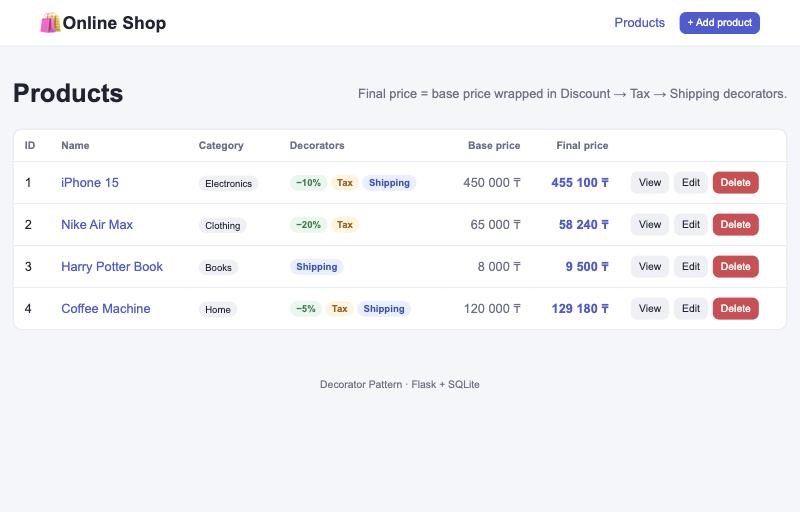
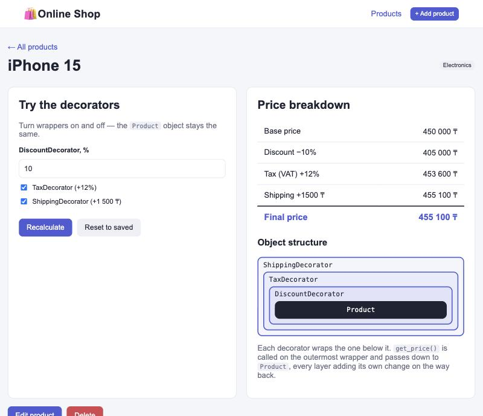
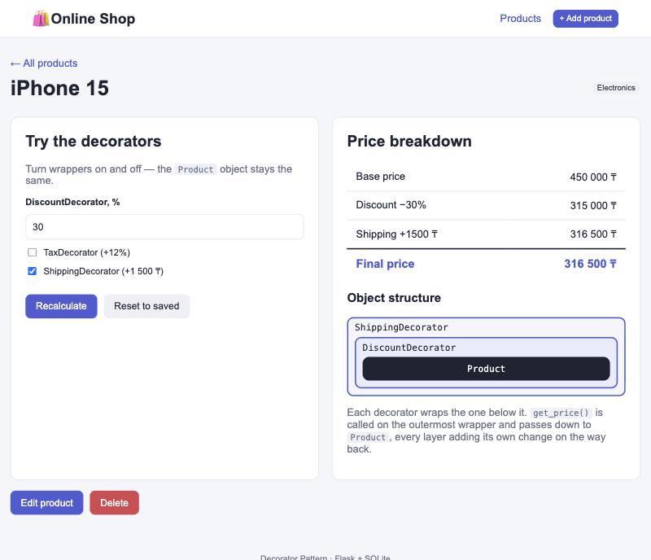
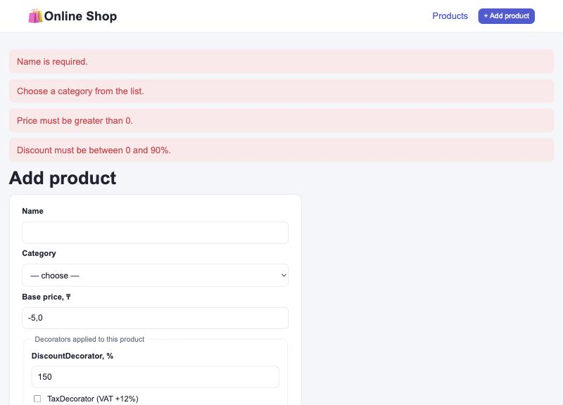
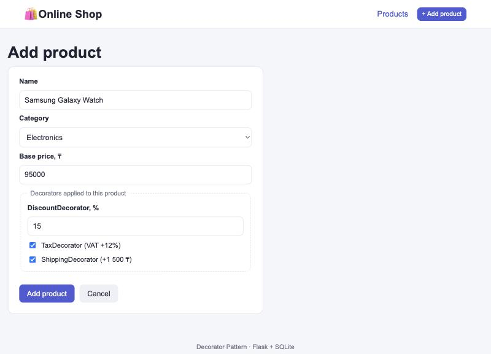
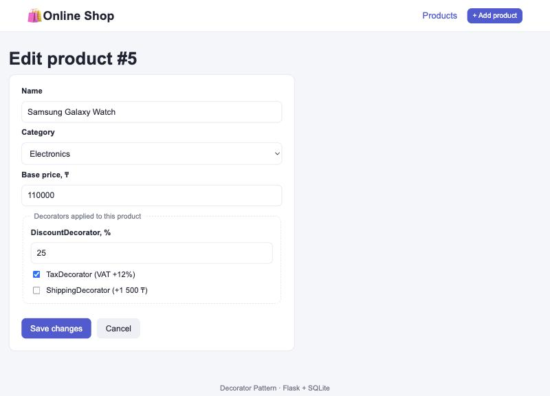
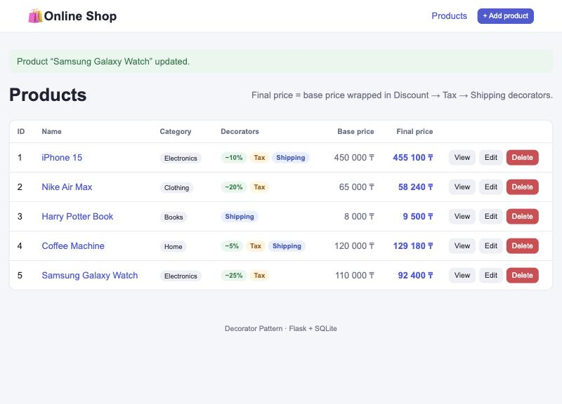
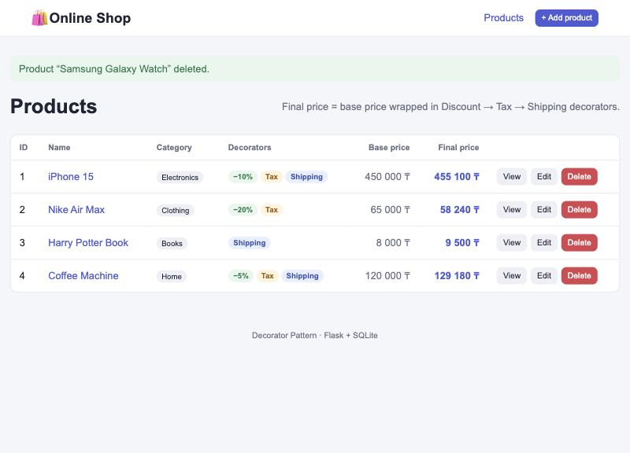
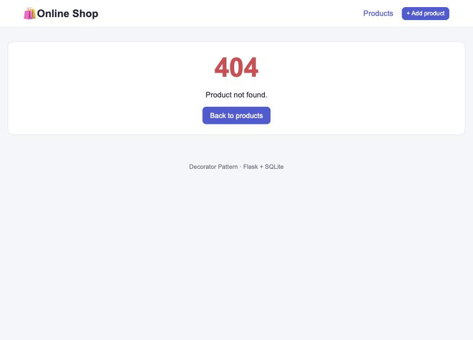

# РК 1: Online Shop Product Management System — паттерн Decorator

**Технологии:** Python 3, Flask, SQLite, HTML, CSS
**Паттерн:** Decorator (Декоратор), структурный паттерн

---

## 1. О проекте

Это веб-приложение для управления товарами интернет-магазина. Для каждого товара
хранятся название, категория и **базовая цена**. Итоговая цена считается так:
базовая цена «оборачивается» декораторами в таком порядке:

| Декоратор | Что делает |
|---|---|
| `DiscountDecorator` | скидка от 0 до 90 % |
| `TaxDecorator` | налог НДС +12 % |
| `ShippingDecorator` | доставка +1 500 ₸ |

Для каждого товара в базе сохраняется, какие декораторы к нему применены.
На странице товара их можно включать и выключать прямо в браузере.
Цена пересчитывается, и видно, как объекты вкладываются друг в друга.

## 2. Структура проекта

```
4/
├── README.md             этот отчёт
├── app.py                Flask-приложение: маршруты CRUD, валидация, обработка ошибок
├── database.py           SQLite: создание таблицы, демо-данные, функции CRUD
├── database.db           база данных SQLite (создаётся автоматически)
├── patterns/
│   └── decorators.py     ПАТТЕРН DECORATOR: Product + DiscountDecorator, TaxDecorator, ShippingDecorator
├── templates/
│   ├── base.html         общий шаблон (шапка, сообщения)
│   ├── index.html        список товаров: базовая и итоговая цена (Read)
│   ├── detail.html       страница товара и демонстрация паттерна
│   ├── add.html          добавление товара (Create)
│   ├── edit.html         редактирование товара (Update)
│   ├── _form.html        общая форма для add/edit
│   └── error.html        страница 404
├── static/style.css      стили
├── requirements.txt      зависимости (Flask)
└── screenshots/          скриншоты работы приложения
```

## 3. Как запустить

```bash
cd ~/Desktop/"Design Pattern/4"
python3 -m venv .venv                         # только в первый раз
.venv/bin/pip install -r requirements.txt     # только в первый раз
.venv/bin/python app.py
```

Открыть в браузере **http://127.0.0.1:5002**. Остановить сервер: `Ctrl + C`.

## 4. База данных

Файл `database.db` создаётся функцией `init_db()` при запуске. Если таблица пустая,
в неё добавляются 4 демо-товара.

**Таблица `products`**

| Колонка | Тип | Описание |
|---|---|---|
| `id` | INTEGER PK | идентификатор |
| `name` | TEXT | название |
| `price` | REAL, > 0 | базовая цена, ₸ |
| `category` | TEXT | категория |
| `discount` | INTEGER, 0–90 | процент скидки (`DiscountDecorator`) |
| `apply_tax` | INTEGER 0/1 | применять ли `TaxDecorator` |
| `apply_shipping` | INTEGER 0/1 | применять ли `ShippingDecorator` |

Первые четыре колонки обязательны по заданию. Последние три хранят выбор декораторов для товара.

## 5. CRUD и маршруты Flask

| Операция | Маршрут | Метод | Что происходит |
|---|---|---|---|
| **Read** | `/` | GET | список товаров с базовой и итоговой ценой |
| **Read** | `/product/<id>` | GET | страница товара: разбор цены и структура декораторов |
| **Create** | `/add` | GET, POST | форма → валидация → `INSERT` |
| **Update** | `/edit/<id>` | GET, POST | форма с текущими данными → валидация → `UPDATE` |
| **Delete** | `/delete/<id>` | POST | подтверждение → `DELETE` |

Удаление работает только через POST, чтобы товар нельзя было удалить простым переходом по ссылке.

### Валидация и ошибки

Функция `read_product_form()` в `app.py` проверяет:

- название не пустое и не длиннее 100 символов;
- категория выбрана из списка;
- цена является числом и больше 0;
- скидка является целым числом от 0 до 90.

Если есть ошибки, форма показывается снова: введённые данные сохраняются, сверху выводятся
красные сообщения, код ответа 400. Если товара нет (`/edit/999`), показывается страница 404.
Кроме того, в самой SQLite стоят ограничения `CHECK`.

## 6. Паттерн Decorator

### Какую проблему решает

К товару можно применить скидку, налог и доставку **в любой комбинации**. Без паттерна
пришлось бы делать отдельный подкласс для каждой комбинации:

```
DiscountedProduct, TaxedProduct, ShippedProduct,
DiscountedTaxedProduct, DiscountedShippedProduct, TaxedShippedProduct,
DiscountedTaxedShippedProduct ...
```

Это 7 классов на 3 опции, а на 4 опции было бы уже 15. Другой вариант без паттерна —
один большой `if` внутри класса `Product`. Тогда для любой новой опции пришлось бы менять `Product`.

**Decorator** решает это так: каждая опция становится маленьким классом-обёрткой.
Обёртки можно вкладывать друг в друга в любом количестве. Класс `Product` при этом
**не меняется**: это принцип открытости/закрытости (Open/Closed).

### Структура (файл `patterns/decorators.py`)

```
                 PriceComponent  (абстрактный интерфейс: get_price(), get_steps())
                  ▲            ▲
                  │            │
              Product     ProductDecorator  ── хранит ссылку _component на PriceComponent
                               ▲
              ┌────────────────┼────────────────┐
     DiscountDecorator    TaxDecorator    ShippingDecorator
```

| Класс | Роль в паттерне |
|---|---|
| `PriceComponent` | **Component**: общий интерфейс для товара и декораторов |
| `Product` | **Concrete Component**: исходный объект, ничего не знает о декораторах |
| `ProductDecorator` | **Base Decorator**: хранит обёрнутый объект и передаёт ему вызовы |
| `DiscountDecorator`, `TaxDecorator`, `ShippingDecorator` | **Concrete Decorators**: добавляют своё поведение |

### Как это работает

```python
product = Product(1, "iPhone 15", 450000, "Electronics")

price = ShippingDecorator(TaxDecorator(DiscountDecorator(product, 10)))
price.get_price()   # 455 100 ₸
```

Вызов `get_price()` проходит по цепочке:

```
ShippingDecorator.get_price()
 └─ TaxDecorator.get_price()
     └─ DiscountDecorator.get_price()
         └─ Product.get_price()             → 450 000
        −10 %                               → 405 000
    +12 % НДС                               → 453 600
 +1 500 доставка                            → 455 100 ₸
```

Каждый декоратор сначала вызывает `super().get_price()` (то есть обёрнутый объект),
а потом меняет результат по-своему.

Функция `apply_decorators()` собирает цепочку из выбранных опций. В `app.py` она
вызывается для каждого товара из базы:

- на главной странице показываются базовая цена (`row.price`) и итоговая (`component.get_price()`);
- на странице товара `get_steps()` выводит разбор цены по шагам, а блок «Object structure»
  показывает вложенность объектов, например `ShippingDecorator → TaxDecorator → DiscountDecorator → Product`.

### Как добавить новую опцию

Например, нужна подарочная упаковка: достаточно написать **один новый класс**.

```python
class GiftWrapDecorator(ProductDecorator):
    def get_price(self):
        return super().get_price() + 1000
    def get_steps(self):
        return super().get_steps() + [("Gift wrap +1000 ₸", self.get_price())]
```

`Product` и остальные декораторы при этом менять не нужно.

## 7. Скриншоты

| | |
|---|---|
| Список товаров: базовая и итоговая цена |  |
| Страница товара: разбор цены и вложенность декораторов |  |
| Декораторы переключены (−30 %, без налога, с доставкой) |  |
| Ошибки валидации |  |
| Create: форма добавления |  |
| Create: товар добавлен |  |
| Update: форма редактирования |  |
| Update: товар обновлён |  |
| Delete: товар удалён |  |
| 404: товар не найден |  |

## 8. Ответы на вопросы защиты

**1. Какую проблему решает приложение?**
Это управление товарами магазина (CRUD) с расчётом итоговой цены. К каждому товару
применяется своя комбинация скидки, налога и доставки.

**2. Какой паттерн реализован?**
Decorator (Декоратор). Это структурный паттерн: он позволяет динамически добавлять объекту
новое поведение, оборачивая его в объекты-обёртки с тем же интерфейсом.

**3. Почему выбран этот паттерн?**
Опции цены независимы и комбинируются как угодно. Decorator позволяет собрать любую
комбинацию во время работы программы, без взрыва количества подклассов и без изменения класса `Product`.

**4. Где паттерн в коде?**
Классы находятся в `patterns/decorators.py`: `PriceComponent`, `Product`, `ProductDecorator`,
`DiscountDecorator`, `TaxDecorator`, `ShippingDecorator`, плюс функция `apply_decorators()`.
Используются они в `app.py`: функция `decorate()` и маршруты `index()` и `detail()`.

**5. Как работают CRUD-операции?**
Форма отправляет данные POST-запросом. `read_product_form()` их проверяет, затем функции из
`database.py` выполняют `INSERT`, `UPDATE` или `DELETE` в SQLite. Для чтения выполняется `SELECT`,
и каждая строка превращается в `Product`, обёрнутый в нужные декораторы.

**6. Что будет, если убрать паттерн?**
Логику цены пришлось бы писать одной функцией с кучей `if` внутри `Product` или делать
подкласс на каждую комбинацию опций. Любая новая опция (упаковка, страховка, промокод)
требовала бы менять уже работающий код, и вырос бы риск ошибок. С декоратором новая опция
означает просто новый класс.
