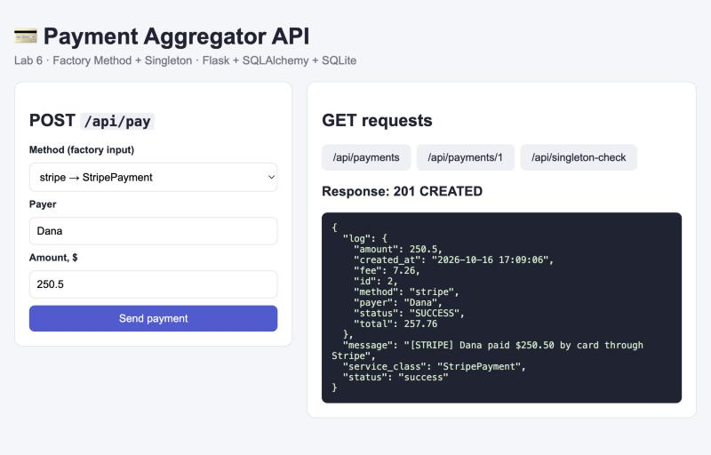
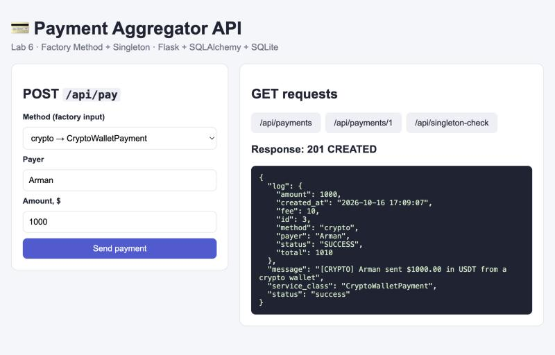
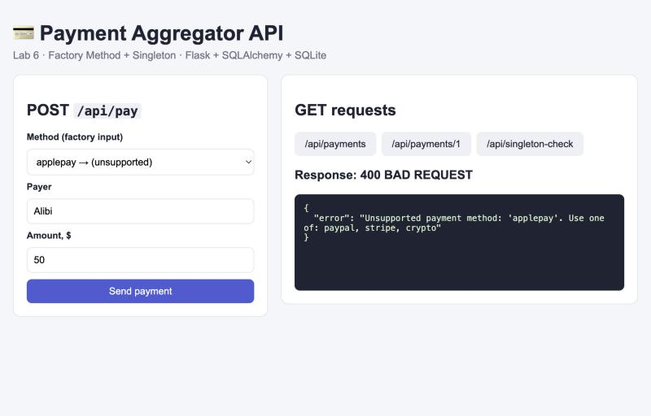
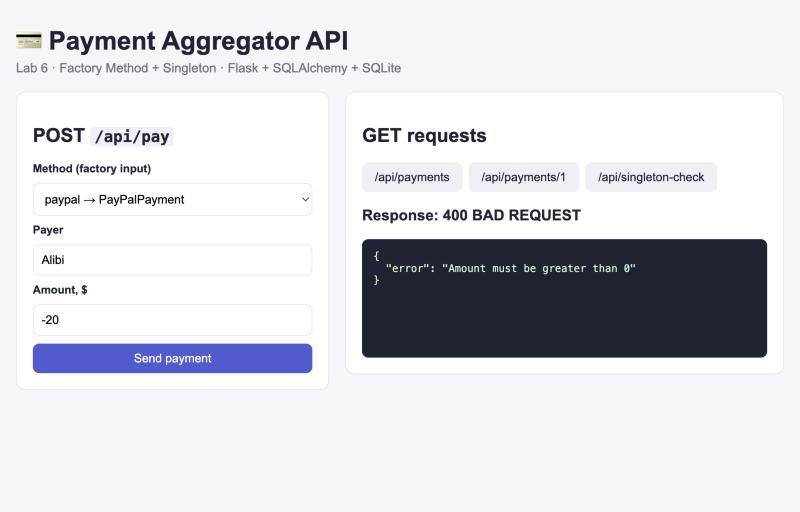
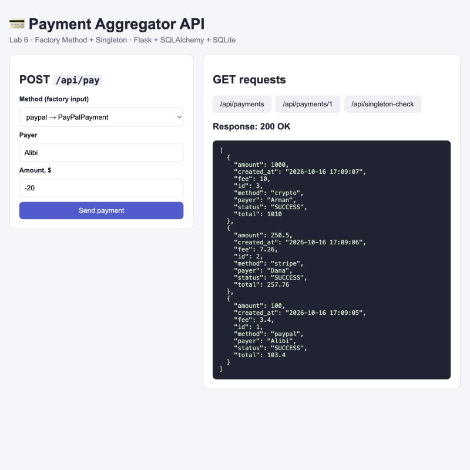
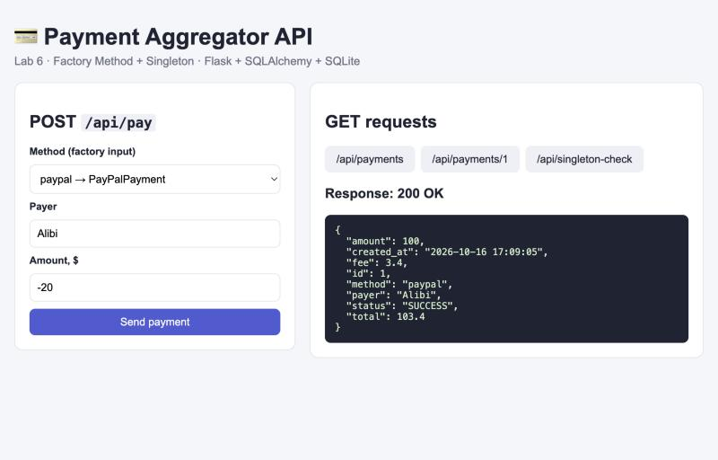
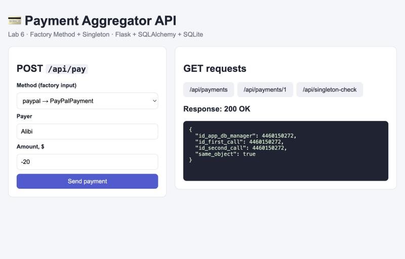

# Lab 6: Payment Aggregator — паттерны Singleton и Factory Method

**Вариант 2:** Payment Aggregator (PayPal, Stripe, Crypto Wallet)
**Технологии:** Python 3, Flask, Flask-SQLAlchemy (ORM), SQLite
**Паттерны:** Singleton (Одиночка), Factory Method (Фабричный метод), порождающие паттерны

---

## 1. О проекте

Это REST API платёжного агрегатора. Клиент отправляет JSON со способом оплаты
(`paypal`, `stripe` или `crypto`), именем плательщика и суммой.

- **Factory Method** по полю `method` сам создаёт нужный платёжный сервис.
- Каждый сервис по-своему проводит оплату и берёт свою комиссию.
- Каждый платёж записывается в SQLite через SQLAlchemy.
- **Singleton** гарантирует, что во всём приложении есть только один `DatabaseManager`.

| Способ | Класс | Комиссия |
|---|---|---|
| `paypal` | `PayPalPayment` | 3.4 % |
| `stripe` | `StripePayment` | 2.9 % |
| `crypto` | `CryptoWalletPayment` | 1.0 % |

## 2. Структура проекта

```
6/
├── app.py              Flask-приложение и маршруты REST API
├── database.py         SINGLETON: DatabaseManager
├── factory.py          FACTORY METHOD: PaymentFactory и платёжные сервисы
├── models.py           модель SQLAlchemy PaymentLog (таблица payment_logs)
├── app_database.db     база данных SQLite (создаётся автоматически)
├── requirements.txt    зависимости (Flask, Flask-SQLAlchemy)
├── templates/
│   └── index.html      страница для проверки API из браузера
└── screenshots/        скриншоты работы
```

## 3. Как запустить

```bash
cd ~/Desktop/"Design Pattern/6"
python3 -m venv .venv                         # только в первый раз
.venv/bin/pip install -r requirements.txt     # только в первый раз
.venv/bin/python app.py
```

Сервер запускается на **http://127.0.0.1:5003**. Порт 5000 на macOS занят системной службой AirPlay.
На главной странице `/` есть форма, через которую можно отправлять запросы к API без Postman.

## 4. REST API

| Метод | Маршрут | Что делает | Ответ |
|---|---|---|---|
| POST | `/api/pay` | провести платёж (фабрика создаёт сервис) и записать в БД | 201 / 400 / 500 |
| GET | `/api/payments` | история всех платежей, новые сверху; фильтр `?method=paypal` | 200 |
| GET | `/api/payments/<id>` | один платёж по id | 200 / 404 |
| GET | `/api/singleton-check` | доказательство Singleton: `DatabaseManager()` всегда один объект | 200 |

### Пример запроса

```bash
curl -X POST http://127.0.0.1:5003/api/pay \
     -H "Content-Type: application/json" \
     -d '{"method": "stripe", "payer": "Alibi", "amount": 49.99}'
```

Ответ `201 Created`:

```json
{
  "status": "success",
  "service_class": "StripePayment",
  "message": "[STRIPE] Alibi paid $49.99 by card through Stripe",
  "log": {
    "id": 4, "method": "stripe", "payer": "Alibi",
    "amount": 49.99, "fee": 1.45, "total": 51.44,
    "status": "SUCCESS", "created_at": "2026-10-16 17:09:33"
  }
}
```

### Валидация и ошибки

| Ситуация | Код | Ответ |
|---|---|---|
| нет `method`, `payer` или `amount`, либо тело не JSON | 400 | `Missing required fields: method, payer, amount` |
| пустой `payer` | 400 | `Payer must not be empty` |
| `amount` не число | 400 | `Amount must be a number` |
| `amount` ≤ 0, `nan` или `inf` | 400 | `Amount must be greater than 0` |
| неизвестный способ оплаты (`applepay`) | 400 | `Unsupported payment method: 'applepay'...` (ошибку бросает фабрика) |
| платёж не найден | 404 | `Payment 99 not found` |
| ошибка базы | 500 | транзакция откатывается через `db.session.rollback()` |

## 5. База данных

Таблица `payment_logs` (модель `PaymentLog` в `models.py`):

| Колонка | Тип | Описание |
|---|---|---|
| `id` | Integer PK | идентификатор |
| `payment_method` | String(50) | `paypal` / `stripe` / `crypto` |
| `payer` | String(100) | плательщик |
| `amount` | Float | сумма платежа |
| `fee` | Float | комиссия сервиса |
| `total` | Float | сумма + комиссия |
| `status` | String(20) | статус, `SUCCESS` |
| `created_at` | DateTime | время платежа |

Записи создаются через ORM (`db.session.add()` и `commit()`), а читаются через `PaymentLog.query`.
Писать SQL вручную не нужно.

## 6. Паттерн Singleton — `database.py`

**Проблема.** Если каждый модуль создаёт своё подключение к базе (`SQLAlchemy()`), получается
несколько пулов соединений. Модели «не видят» друг друга, а данные легко рассинхронизировать.

**Решение.** У класса `DatabaseManager` может быть только один объект:

```python
class DatabaseManager:
    _instance = None

    def __new__(cls, app=None):
        if cls._instance is None:                # первый вызов: создаём объект
            cls._instance = super().__new__(cls)
            cls._instance.db = SQLAlchemy()
            cls._instance._initialized_app = None
        if app is not None:
            cls._instance.init_app(app)
        return cls._instance                     # все вызовы возвращают его же
```

- `__new__` вызывается **до** создания объекта. Если объект уже есть, возвращается старый.
- `database.py` создаёт `db_manager = DatabaseManager()`, а `app.py` вызывает `DatabaseManager(app)`.
  Это **тот же самый** объект: `/api/singleton-check` возвращает `same_object: true` и одинаковые `id()`.

> **Найденная ошибка в шаблоне из задания.** В PDF проверка `if app:` стоит *внутри*
> `if cls._instance is None`. Но объект уже создан строкой `db_manager = DatabaseManager()`
> при импорте. Поэтому `DatabaseManager(app)` в `app.py` **никогда не вызывал** `init_app()`:
> база не подключалась и таблицы не создавались. Здесь проверка вынесена наружу, а повторное
> подключение того же app блокируется флагом `_initialized_app`.

## 7. Паттерн Factory Method — `factory.py`

**Проблема.** Без фабрики в `app.py` пришлось бы писать
`if method == "paypal": PayPalPayment() elif ...`. Маршрут знал бы обо всех платёжных
классах, и для нового способа оплаты пришлось бы менять код API.

**Решение.** Объект создаёт фабрика. Маршрут работает только с общим интерфейсом:

```
            BasePaymentService (ABC)     ← интерфейс «продукта»: pay(), calculate_fee()
             ▲         ▲          ▲
   PayPalPayment  StripePayment  CryptoWalletPayment   ← конкретные продукты

   PaymentFactory.create_payment_service("stripe")  →  StripePayment()   ← создатель
```

```python
service = PaymentFactory.create_payment_service(data["method"])  # какой класс, решает фабрика
result_message = service.pay(payer, amount)                     # полиморфизм
fee = service.calculate_fee(amount)
```

- `app.py` **не знает**, какой именно класс создан. Ему достаточно, что у объекта есть `pay()`
  и `calculate_fee()`.
- Чтобы добавить новый способ оплаты (например, Kaspi), нужно написать один класс и добавить
  одну строку в словарь `_services`. Маршруты и модель менять не нужно: это принцип Open/Closed.
- Неизвестный способ оплаты фабрика отклоняет через `ValueError`, а API превращает его в ответ 400.

## 8. Скриншоты

| | |
|---|---|
| PayPal: фабрика создала `PayPalPayment` |  |
| Stripe: `StripePayment` |  |
| Crypto Wallet: `CryptoWalletPayment` |  |
| Неизвестный способ: фабрика вернула ошибку |  |
| Валидация: отрицательная сумма |  |
| GET `/api/payments`: история из SQLite |  |
| GET `/api/payments/1` |  |
| GET `/api/singleton-check`: один и тот же объект |  |

## 9. Возможные вопросы на защите

**Зачем Singleton для базы данных?**
Подключение к базе должно быть одно на всё приложение. Иначе появляются лишние соединения,
модели оказываются привязаны к разным `SQLAlchemy()`, и `create_all()` не видит таблицы.

**Как доказать, что объект один?**
`DatabaseManager() is DatabaseManager()` даёт `True`, и `id()` у них одинаковые. Это показывает `/api/singleton-check`.

**Чем Factory Method лучше `if/elif` прямо в маршруте?**
Создание объектов собрано в одном месте. Маршрут зависит только от абстракции `BasePaymentService`.
Новый способ оплаты добавляется без изменения API.

**Где здесь полиморфизм?**
`service.pay()` вызывается одинаково, но PayPal, Stripe и Crypto выполняют его по-разному,
и комиссия у каждого своя.

**Чем Factory Method отличается от Abstract Factory?**
Factory Method создаёт **один** объект (платёжный сервис). Abstract Factory создаёт
**семейство** связанных объектов, например сервис + чек + валидатор для одного провайдера.

**Что будет без паттернов?**
Без Singleton появятся несколько подключений и рассинхрон. Без фабрики будет жёсткая связь
маршрута со всеми классами, а каждое новое платёжное решение потребует правки `app.py`.
