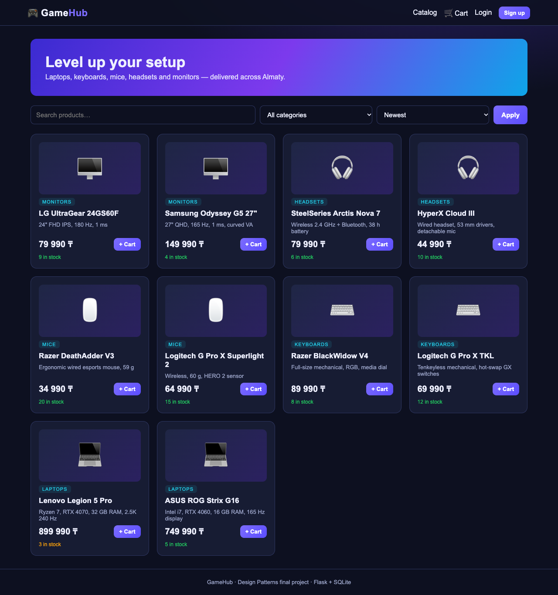
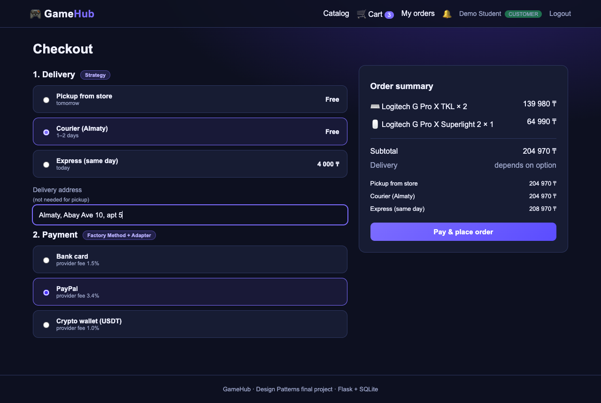
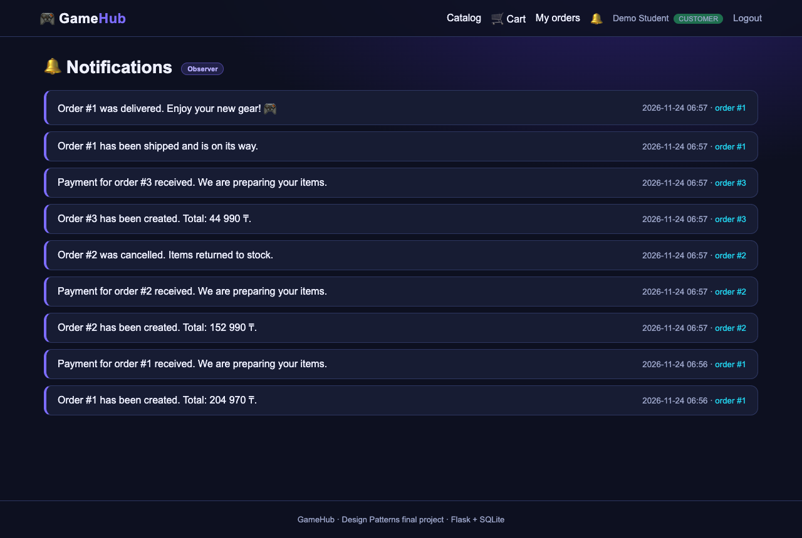

# Итоговый проект: GameHub — интернет-магазин игровой техники

**Технологии:** Python 3, Flask, SQLite, HTML, CSS, unittest + coverage, Bandit (SAST)
**Паттерны:** Factory Method, Singleton, Adapter, Observer, Strategy (+ Repository)
**Команда:** Alibi Auyespek (40195) · Zhiyengali Ruslan (43472) · Kim David (39004)
**Преподаватель:** Dina Aldanazarova

---

## 1. О проекте

GameHub — веб-магазин игровой техники: ноутбуки, клавиатуры, мыши, гарнитуры, мониторы.
Проект развивает Smart Game Store из Lab 7 до полноценного магазина:
каталог → корзина → оформление заказа → оплата → доставка → уведомления.

| Роль | Логин / пароль | Что может |
|---|---|---|
| Гость | — | смотреть каталог, искать и фильтровать товары, собирать корзину, зарегистрироваться |
| Покупатель | `student` / `student123` | всё, что гость, плюс оформлять и оплачивать заказы, отменять их, видеть свои заказы и уведомления |
| Администратор | `admin` / `admin123` | дашборд; CRUD товаров и категорий; все заказы; смена статуса заказа (отправлен / доставлен / отменён) |

**Какую проблему решает.** Каталог, приём оплаты разными способами, расчёт доставки и
информирование клиента собраны в одном приложении. Новый способ оплаты, новый тариф доставки
или новый канал уведомлений добавляется **новым классом**, без переписывания старого кода.

Техническое задание (шаблон кафедры): [docs/Technical_Specification_GameHub.docx](docs/Technical_Specification_GameHub.docx).

## 2. Структура проекта

```
final-project-gamehub/
├── README.md                этот отчёт
├── app.py                   точка входа: create_app(), сборка паттернов, CSRF, ошибки
├── seed.py                  создание схемы и демо-данных (пользователи с хэшами паролей)
├── gamehub.db               база данных SQLite (с демо-заказами)
├── requirements.txt         Flask, coverage, bandit
├── database/
│   ├── schema.sql           схема БД: 7 таблиц, ключи, ограничения, индексы
│   └── seed.sql             демо-категории и товары
├── models/
│   └── entities.py          Model: User, Category, Product, Order, OrderItem, Payment, Notification
├── repositories/
│   └── repositories.py      Repository: весь SQL приложения (параметризованные запросы)
├── services/                бизнес-логика
│   ├── auth_service.py      регистрация, вход, хэширование паролей
│   ├── catalog_service.py   валидация и CRUD товаров и категорий
│   ├── cart_service.py      корзина в сессии (цены всегда берутся из БД)
│   └── order_service.py     checkout: связывает Strategy + Factory + Adapter + Observer
├── patterns/                5 паттернов из каталога ТЗ
│   ├── payment_factory.py   1. Factory Method — PaymentFactory
│   ├── singleton_database.py 2. Singleton     — Database
│   ├── payment_adapters.py  3. Adapter        — BankCardAdapter, PayPalAdapter, CryptoWalletAdapter
│   ├── order_observer.py    4. Observer       — OrderEventManager + 3 наблюдателя
│   └── delivery_strategy.py 5. Strategy       — Pickup / Courier / Express
├── controllers/             Flask Blueprints (маршруты)
│   ├── auth_controller.py   /login, /register, /logout
│   ├── shop_controller.py   каталог, товар, корзина, checkout
│   ├── order_controller.py  мои заказы, отмена, уведомления
│   ├── admin_controller.py  админ-панель
│   └── helpers.py           текущий пользователь, login_required, admin_required
├── templates/               HTML (Jinja2), templates/admin/ — страницы администратора
├── static/style.css         стили (тёмная «игровая» тема, адаптивная вёрстка)
├── tests/                   40 тестов: test_patterns.py (unit), test_app.py (integration)
├── security/                отчёты Bandit (скан 1 и 2) и отчёт о покрытии
├── docs/                    техническое задание (.docx)
└── screenshots/             22 скриншота работы приложения
```

## 3. Как запустить

```bash
cd ~/Desktop/"Design Pattern/final-project-gamehub"
python3 -m venv .venv                         # только в первый раз
.venv/bin/pip install -r requirements.txt     # только в первый раз
.venv/bin/python app.py
```

Открыть **http://127.0.0.1:5005**. Остановить — `Ctrl + C`.
База `gamehub.db` создаётся сама из `database/schema.sql` и `database/seed.sql`.

| Переменная окружения | Зачем |
|---|---|
| `GAMEHUB_SECRET_KEY` | секретный ключ сессий. Если не задан — генерируется случайный при каждом запуске |
| `GAMEHUB_DEBUG=1` | включить режим отладки Flask (только для локальной разработки) |

Тесты, покрытие и SAST:

```bash
.venv/bin/python -m unittest discover -s tests -t . -v
.venv/bin/coverage run --source=. --omit='.venv/*,tests/*,seed.py' -m unittest discover -s tests -t . && .venv/bin/coverage report
.venv/bin/bandit -r . -x ./.venv,./tests
```

## 4. Архитектура (слоистая, как в Lab 12)

```
 Браузер
    │  HTTP
    ▼
 VIEW         templates/*.html               ← только отображение
    ▲
 CONTROLLER   controllers/*_controller.py    ← принимает запрос, вызывает сервис, рендерит шаблон
    │
 SERVICE      services/*.py                  ← бизнес-правила, валидация
    │            └─ patterns/ (Strategy, Factory Method, Adapter, Observer)
 REPOSITORY   repositories/repositories.py   ← весь SQL
    │
 DATABASE     patterns/singleton_database.py → gamehub.db (SQLite)
```

Каждый слой знает только о слое под собой. Контроллер не пишет SQL, сервис не знает про
HTML, репозиторий не знает про Flask.

**Как проходит оформление заказа** (`OrderService.checkout()`):

```
Нажатие «Pay & place order»
  └─► shop_controller.checkout()
        └─► OrderService.checkout(user, items, "courier", "paypal", address)
              1. проверка корзины и остатков            ProductRepository
              2. DeliveryContext.for_code("courier")   ── Strategy        → стоимость доставки
              3. PaymentFactory.create("paypal")       ── Factory Method  → PayPalAdapter
              4. OrderRepository.create(...)            ── Repository      (заказ + позиции, одна транзакция)
              5. events.notify(ORDER_CREATED)           ── Observer
              6. PayPalAdapter.pay(...)                 ── Adapter         → PayPalSDK.create_payment({...})
              7. PaymentRepository.create(...), статус PAID
              8. events.notify(ORDER_PAID)              ── Observer → уведомление + списание остатков + лог
```

## 5. Паттерны проектирования

### 5.1 Factory Method (порождающий) — `patterns/payment_factory.py`

**Проблема.** Форма оплаты присылает только строку (`card`, `paypal`, `crypto`). Без фабрики
сервис содержал бы `if method == "card": BankCardAdapter() elif ...`, и каждый новый способ
оплаты требовал бы правки бизнес-логики.

**Решение.** `PaymentFactory.create(method)` по реестру выбирает класс и создаёт объект.
Новый провайдер = новый класс + `PaymentFactory.register(NewAdapter)`.

| Роль | Класс |
|---|---|
| Creator | `PaymentFactory` |
| Product (интерфейс) | `PaymentProcessor` |
| Concrete Products | `BankCardAdapter`, `PayPalAdapter`, `CryptoWalletAdapter` |

```python
processor = PaymentFactory.create("paypal")   # -> PayPalAdapter
result = processor.pay("student", 204970)
```

### 5.2 Singleton (порождающий) — `patterns/singleton_database.py`

**Проблема.** Путь к БД, `PRAGMA foreign_keys = ON`, создание схемы должны настраиваться в
**одном** месте. Много объектов «базы» с разными настройками — источник ошибок.

**Решение.** `Database.__new__` всегда возвращает один и тот же объект
(double-checked locking — безопасно при нескольких потоках). Синглтон выдаёт **новое
соединение на каждую операцию** через `transaction()`: SQLite-соединения нельзя делить между
потоками Flask, а `transaction()` делает `commit` при успехе и `rollback` при ошибке.

```python
db = Database()          # всегда один и тот же объект
with db.transaction() as conn:
    conn.execute("UPDATE products SET stock = stock - ? WHERE id = ?", (2, 3))
```

### 5.3 Adapter (структурный) — `patterns/payment_adapters.py`

**Проблема.** У каждого платёжного провайдера своё SDK с несовместимым интерфейсом:

| SDK (Adaptee) | Интерфейс | Что ждёт |
|---|---|---|
| `BankCardGateway` | `charge_tiyn(token, amount_tiyn) -> int` | сумму в **тиынах** |
| `PayPalSDK` | `create_payment(dict) -> dict` | словарь с суммой в **USD-строке** |
| `CryptoWalletAPI` | `send_usdt(wallet, amount_str, memo) -> str` | сумму в **USDT-строке** |

**Решение.** Каждый адаптер реализует общий интерфейс `PaymentProcessor.pay(payer, amount_kzt)`
и внутри переводит вызов: тенге → тиыны / доллары / USDT, а ответ SDK → `PaymentResult`.
`OrderService` работает с любым провайдером одинаково.

```python
class PayPalAdapter(PaymentProcessor):
    def pay(self, payer, amount):
        usd = f"{amount / KZT_PER_USD:.2f}"                       # ₸ -> USD
        response = self._sdk.create_payment({"total": usd, "currency": "USD"})
        return PaymentResult("paypal", amount, self.fee_for(amount), response["id"], ...)
```

> SDK — локальные симуляции (реальные деньги не списываются), но интерфейсы намеренно разные.

### 5.4 Observer (поведенческий) — `patterns/order_observer.py`

**Проблема.** Когда заказ создан, оплачен, отправлен или отменён, нужно: написать покупателю,
изменить остатки на складе, записать событие в журнал. Если всё это вызывать прямо из
`OrderService`, он будет знать про уведомления, склад и логи — сильная связанность.

**Решение.** `OrderEventManager` (Subject) хранит подписчиков и вызывает `update()` у каждого.

| Наблюдатель | Реакция |
|---|---|
| `NotificationObserver` | пишет сообщение во «входящие» покупателя (таблица `notifications`, страница 🔔) |
| `StockObserver` | при оплате списывает товар со склада, при отмене оплаченного заказа — возвращает |
| `AuditLogObserver` | пишет строку в `logs/orders.log` |

```python
events = OrderEventManager()
events.subscribe(NotificationObserver(NotificationRepository()))
events.subscribe(StockObserver(ProductRepository()))
events.subscribe(AuditLogObserver())
...
self.events.notify(ORDER_PAID, order.as_event())   # все три реагируют сами
```

Новая реакция (e-mail, Telegram) = новый наблюдатель + одна строка `subscribe()`.

### 5.5 Strategy (поведенческий) — `patterns/delivery_strategy.py`

**Проблема.** Стоимость доставки считается по-разному, и тарифы меняются.

| Стратегия | Правило | Срок |
|---|---|---|
| `PickupStrategy` | бесплатно | завтра |
| `CourierStrategy` | 1 500 ₸, **бесплатно от 150 000 ₸** | 1–2 дня |
| `ExpressStrategy` | 3 000 ₸ + 500 ₸ за каждый товар после первого | сегодня |

**Решение.** Каждый алгоритм — отдельный класс с методом `calculate()`. `DeliveryContext`
хранит выбранную стратегию и делегирует ей расчёт. На странице оформления цена для **всех**
стратегий считается сразу, и покупатель видит разницу.

```python
DeliveryContext.for_code("courier").cost(subtotal=204970, items_count=3)   # 0 — бесплатно от 150 000 ₸
DeliveryContext.for_code("express").cost(subtotal=204970, items_count=3)   # 4000
```

### 5.6 Repository (доступ к данным) — `repositories/repositories.py`

Весь SQL приложения — в одном файле, в классах `UserRepository`, `CategoryRepository`,
`ProductRepository`, `OrderRepository`, `PaymentRepository`, `NotificationRepository`.
Они возвращают объекты из `models/entities.py`, а не строки SQLite.
Все запросы параметризованы (`?`), сортировка — только из белого списка.

### Сводная таблица

| # | Паттерн | Категория | Какую проблему решает | Главные классы |
|---|---|---|---|---|
| 1 | Factory Method | Порождающий | создание платёжного сервиса по строке | `PaymentFactory` |
| 2 | Singleton | Порождающий | одна точка доступа к БД | `Database` |
| 3 | Adapter | Структурный | несовместимые интерфейсы платёжных SDK | `PayPalAdapter` и др. |
| 4 | Observer | Поведенческий | реакции на события заказа | `OrderEventManager` |
| 5 | Strategy | Поведенческий | разные алгоритмы расчёта доставки | `DeliveryContext` |

## 6. База данных

SQLite, 7 таблиц ([database/schema.sql](database/schema.sql)). Включены внешние ключи
(`PRAGMA foreign_keys = ON`), `CHECK`-ограничения и индексы.

```
users 1───* orders 1───* order_items *───1 products *───1 categories
  │            │
  │            └──1───* payments
  └──1───* notifications *───0..1 orders
```

| Таблица | Назначение | Важные колонки |
|---|---|---|
| `users` | покупатели и администраторы | `username` UNIQUE, `password_hash`, `role` CHECK (admin/customer) |
| `categories` | категории товаров | `name` UNIQUE |
| `products` | товары | `category_id` FK (RESTRICT), `price` ≥ 0, `stock` ≥ 0, `icon` |
| `orders` | заказы | `user_id` FK, `status` CHECK (NEW/PAID/SHIPPED/DELIVERED/CANCELLED), `delivery_method`, `delivery_cost`, `subtotal`, `total`, `address` |
| `order_items` | позиции заказа | `order_id` FK (CASCADE), `product_id` FK (RESTRICT), `quantity` > 0, `unit_price` (цена на момент покупки) |
| `payments` | платежи | `order_id` FK, `method`, `amount`, `fee`, `transaction_id` |
| `notifications` | входящие покупателя (пишет Observer) | `user_id` FK, `order_id`, `message`, `is_read` |

**Транзакции.** Заказ и все его позиции сохраняются в **одной** транзакции
(`OrderRepository.create`): либо всё, либо ничего.

## 7. CRUD и маршруты

| Сущность | Create | Read | Update | Delete |
|---|---|---|---|---|
| Товары (admin) | `POST /admin/products/add` | `GET /`, `/product/<id>`, `/admin/products` | `POST /admin/products/<id>/edit` | `POST /admin/products/<id>/delete` |
| Категории (admin) | `POST /admin/categories` | `GET /admin/categories` | `POST /admin/categories/<id>/edit` | `POST /admin/categories/<id>/delete` |
| Заказы | `POST /checkout` | `GET /orders/`, `/orders/<id>`, `/admin/orders` | `POST /admin/orders/<id>/status`, `POST /orders/<id>/cancel` | `POST /admin/orders/<id>/delete` |
| Корзина | `POST /cart/add/<id>` | `GET /cart` | `POST /cart/update/<id>` | `POST /cart/remove/<id>` |
| Пользователи | `POST /register` | `POST /login` | — | — |

Правила: товар, который есть в заказах, удалить нельзя (`ON DELETE RESTRICT`), — предлагается
поставить остаток 0. Категорию с товарами удалить нельзя. Удалить можно только отменённый или
доставленный заказ.

## 8. Безопасность

| Мера | Где |
|---|---|
| Пароли хранятся только как соль + хэш (`werkzeug.security`) | `services/auth_service.py` |
| Параметризованные SQL-запросы, сортировка из белого списка | `repositories/repositories.py` |
| CSRF-токен в каждой POST-форме | `app.py` → `csrf_protect()` |
| Проверка прав **на сервере**: `admin_required` → 403 | `controllers/helpers.py` |
| Цены в корзине берутся из БД, а не из cookie | `services/cart_service.py` |
| Защита от open redirect после входа (`next` — только локальный путь) | `controllers/auth_controller.py` |
| Экранирование вывода (Jinja2 autoescape) | все шаблоны |
| Секретный ключ и debug — из переменных окружения | `app.py` |

### SAST — Bandit 1.9.4

| Уровень | Скан 1 | Скан 2 (после исправлений) |
|---|---|---|
| High | 1 | 0 |
| Medium | 0 | 0 |
| Low | 1 | 0 |

| ID | Находка | Где | Уровень | Решение |
|---|---|---|---|---|
| S-01 | B201 `flask_debug_true` — `app.run(debug=True)` открывает отладчик Werkzeug (выполнение кода) | `app.py` | High | **Исправлено:** debug выключен, включается только через `GAMEHUB_DEBUG=1` |
| S-02 | B105 `hardcoded_password_string` — секретный ключ в коде | `app.py` | Low | **Исправлено:** ключ из `GAMEHUB_SECRET_KEY`, иначе `secrets.token_hex(32)` |

Полные отчёты: [security/bandit_scan1.txt](security/bandit_scan1.txt), [security/bandit_scan2.txt](security/bandit_scan2.txt).

## 9. Тестирование

40 автоматических тестов (`unittest`), все проходят.

| Файл | Тип | Что проверяет |
|---|---|---|
| `tests/test_patterns.py` | unit | Singleton (один объект, потоки, rollback), Factory Method (выбор, ошибка, регистрация нового), Adapter (перевод в тиыны / USD / USDT, отказ PayPal), Strategy (все тарифы, смена стратегии), Observer (рассылка, отписка, уведомления, склад, журнал) |
| `tests/test_app.py` | integration | репозитории (сохранение и чтение, поиск, защита от SQL-инъекции), сервисы (регистрация и хэш, валидация товаров и категорий, корзина, полный checkout, отмена с возвратом остатков), маршруты (403 для покупателя, login_required, весь путь покупки через HTTP, CRUD администратора, CSRF) |

| ID | Компонент | Описание | Ожидаемый результат | Статус |
|---|---|---|---|---|
| TC-01 | Observer | подписать двух наблюдателей и вызвать событие | оба получили событие | Pass |
| TC-02 | Repository | сохранить товар и прочитать его | данные совпадают | Pass |
| TC-03 | Singleton | создать `Database()` из 20 потоков | один и тот же объект | Pass |
| TC-04 | Factory Method | `create("cash")` | `ValueError` | Pass |
| TC-05 | Adapter | оплата 1 500.50 ₸ картой | шлюз получил 150 050 тиынов | Pass |
| TC-06 | Strategy | курьер для 150 000 ₸ | доставка 0 ₸ | Pass |
| TC-07 | Checkout | заказ на 2 товара, оплата PayPal | статус PAID, остаток уменьшился, 2 уведомления | Pass |
| TC-08 | Security | покупатель открывает `/admin/` | 403 | Pass |
| TC-09 | Security | поиск `' OR 1=1 --` | пустой результат, БД цела | Pass |

**Покрытие:** 85% всего кода, **93%** ядра (`patterns/`, `services/`, `repositories/`, `models/`);
все 5 модулей паттернов — 95–100%. Отчёт: [security/coverage_report.txt](security/coverage_report.txt).

## 10. Скриншоты







| № | Файл | Что показано |
|---|---|---|
| 1 | [01_catalog.png](screenshots/01_catalog.png) | Каталог (гость) |
| 2 | [02_catalog_filter.png](screenshots/02_catalog_filter.png) | Фильтр по категории «Mice» и сортировка по цене |
| 3 | [03_product_page.png](screenshots/03_product_page.png) | Страница товара |
| 4 | [04_cart.png](screenshots/04_cart.png) | Корзина |
| 5 | [05_checkout_strategy_factory.png](screenshots/05_checkout_strategy_factory.png) | Оформление: выбор доставки (Strategy) и оплаты (Factory Method + Adapter), цены по всем тарифам |
| 6 | [06_order_paid.png](screenshots/06_order_paid.png) | Заказ оплачен через PayPal, транзакция `PAYID-…` |
| 7 | [07_order_cancelled.png](screenshots/07_order_cancelled.png) | Покупатель отменил заказ (оплата криптой, хэш `0x…`) |
| 8 | [08_checkout_validation.png](screenshots/08_checkout_validation.png) | Ошибка: курьер без адреса |
| 9 | [09_my_orders.png](screenshots/09_my_orders.png) | Мои заказы и их статусы |
| 10 | [10_proxy_access_denied.png](screenshots/10_proxy_access_denied.png) | Покупатель открыл `/admin/` → 403 |
| 11 | [11_admin_dashboard.png](screenshots/11_admin_dashboard.png) | Дашборд администратора: выручка, заказы, мало на складе |
| 12 | [12_admin_orders.png](screenshots/12_admin_orders.png) | Все заказы с фильтром по статусу |
| 13 | [13_status_changed_observer.png](screenshots/13_status_changed_observer.png) | Заказ → DELIVERED, «Observers notified» |
| 14 | [14_admin_add_product.png](screenshots/14_admin_add_product.png) | Добавление товара (Create) |
| 15 | [15_product_added.png](screenshots/15_product_added.png) | Товар добавлен |
| 16 | [16_product_updated.png](screenshots/16_product_updated.png) | Цена изменена (Update) |
| 17 | [17_admin_validation.png](screenshots/17_admin_validation.png) | Валидация: отрицательная цена |
| 18 | [18_delete_blocked.png](screenshots/18_delete_blocked.png) | Товар из заказа удалить нельзя |
| 19 | [19_product_deleted.png](screenshots/19_product_deleted.png) | Удаление товара (Delete) |
| 20 | [20_categories.png](screenshots/20_categories.png) | CRUD категорий |
| 21 | [21_notifications_observer.png](screenshots/21_notifications_observer.png) | Уведомления, созданные `NotificationObserver` |
| 22 | [22_order_delivered.png](screenshots/22_order_delivered.png) | Детали заказа: статус DELIVERED, шкала статусов, платёж |

## 11. Соответствие техническому заданию

| Требование ТЗ | Где выполнено |
|---|---|
| Минимум 5 паттернов, у каждого — проблема, участники, расположение, код | раздел 5, папка `patterns/` |
| БД минимум из 4 таблиц, ER-диаграмма, словарь данных | раздел 6, 7 таблиц, `database/schema.sql` |
| Слой доступа к данным: Repository, Singleton, транзакции, параметризованные запросы, `schema.sql` + `seed.sql` | разделы 5.2, 5.6, 6 |
| Интерфейсы (скриншоты) | раздел 10 |
| Стратегия тестирования, тест-кейсы, покрытие | раздел 9 |
| SAST: два скана, исправление всех High | раздел 8 |
| Инструкция по запуску | раздел 3 |

## 12. Риски и ограничения

| Риск / ограничение | Влияние | Что можно сделать |
|---|---|---|
| Платёжные SDK — симуляции | Среднее | подключить sandbox-режимы реальных провайдеров через те же адаптеры |
| SQLite при большой нагрузке | Среднее | перейти на PostgreSQL — поменяется только `Database` и SQL в репозиториях |
| Встроенный сервер Flask | Низкое (учебный проект) | запуск через gunicorn за nginx |
| Уведомления только внутри сайта | Низкое | добавить `EmailObserver` / `TelegramObserver` — без изменения `OrderService` |
