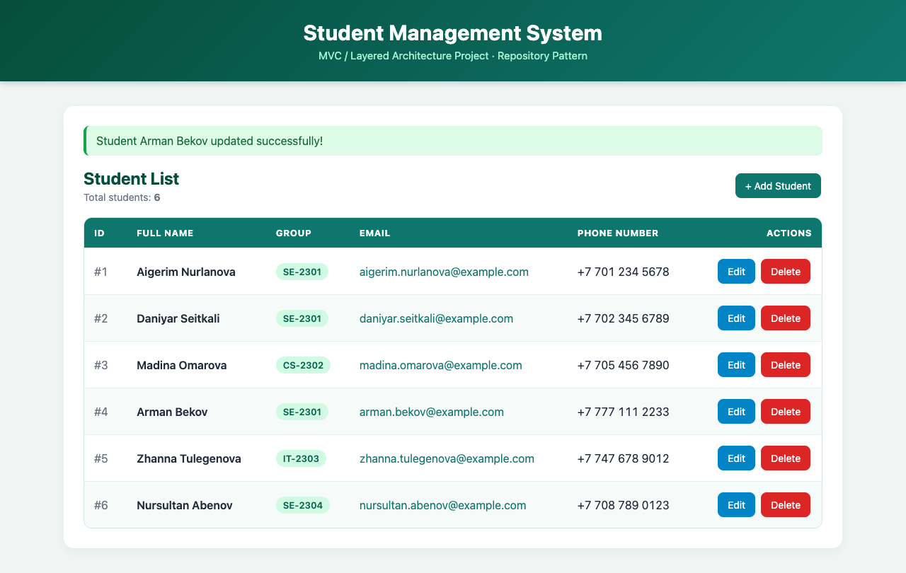
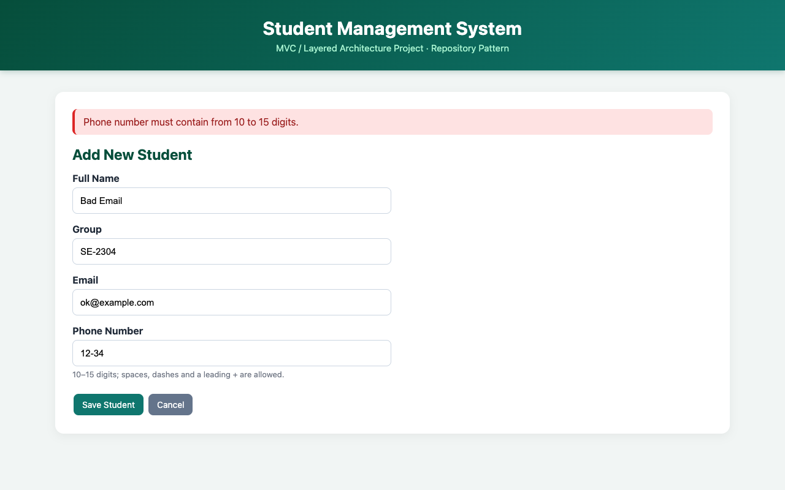

# Лабораторная работа 12: Student Management System — MVC / слоистая архитектура

**Технологии:** Python 3, Flask, SQLite, HTML, CSS
**Паттерн:** Repository (Репозиторий)
**Архитектура:** MVC / Layered Architecture (слоистая архитектура)

---

## 1. О проекте

Student Management System — веб-приложение для учёта студентов. В нём можно **добавлять**,
**просматривать**, **редактировать** и **удалять** студентов (CRUD). У каждого студента есть
ФИО, группа, email и номер телефона.

Главная цель работы — показать, как приложение делится на **слои** (View → Controller →
Service → Repository → Database) и как паттерн **Repository** отделяет работу с базой данных
от бизнес-логики.

Сверх базового кода из задания выполнены практические задачи раздела 13:

- **Task 2** — при первом запуске в базу добавляются 5 демо-студентов;
- **Task 5** — новое поле **Phone Number** проходит через все слои (БД → Repository →
  Service → Controller → шаблоны), с проверкой формата;
- **Task 6** — новый цвет шапки (изумрудный градиент) и улучшенная таблица;
- класс `Student` (Model) **реально используется**: репозиторий превращает строки SQLite
  в объекты `Student` через `Student.from_row()`;
- **Task 7, Task 8** — объяснение архитектуры и паттерна (разделы 5 и 6 этого отчёта).

## 2. Структура проекта

```
lab12/
├── README.md                     этот отчёт
├── app.py                        точка входа: создаёт Flask, регистрирует Blueprint, страница 404
├── database.py                   подключение к SQLite, создание/миграция таблицы, демо-данные
├── students.db                   база данных SQLite (создаётся автоматически)
├── requirements.txt              зависимости (Flask)
├── models/
│   ├── __init__.py
│   └── student.py                MODEL — класс Student + from_row()
├── controllers/
│   ├── __init__.py
│   └── student_controller.py     CONTROLLER — маршруты Flask (Blueprint "student")
├── services/
│   ├── __init__.py
│   └── student_service.py        SERVICE — бизнес-логика и проверка данных
├── repositories/
│   ├── __init__.py
│   └── student_repository.py     REPOSITORY — все SQL-запросы к таблице students
├── templates/                    VIEW — HTML-шаблоны Jinja2
│   ├── base.html                     общий шаблон: шапка, уведомления (flash)
│   ├── students.html                 список студентов (таблица)
│   ├── add_student.html              форма добавления
│   ├── edit_student.html             форма редактирования
│   └── 404.html                      страница «студент не найден»
├── static/style.css              VIEW — стили
└── screenshots/                  скриншоты работы приложения
```

## 3. Как запустить

```bash
cd ~/Desktop/"Design Pattern/lab12"
python3 -m venv .venv                         # только в первый раз
.venv/bin/pip install -r requirements.txt     # только в первый раз
.venv/bin/python app.py
```

Открыть в браузере **http://127.0.0.1:5004**. Остановить сервер — `Ctrl + C`.

> Используется порт **5004**, а не 5000: на macOS порт 5000 занят системной службой
> AirPlay Receiver, а порты 5001–5003 заняты другими лабораторными.

## 4. База данных

Файл `students.db` создаётся автоматически функцией `create_database()` из `database.py`
при запуске. Если таблица пустая, в неё добавляются 5 демо-студентов.

**students** — студенты

| Колонка | Тип | Описание |
|---|---|---|
| id | INTEGER | первичный ключ, `AUTOINCREMENT` |
| name | TEXT | ФИО, обязательно |
| student_group | TEXT | группа, обязательно |
| email | TEXT | email, обязательно |
| phone | TEXT | номер телефона, `NOT NULL DEFAULT ''` (**новое поле, Task 5**) |

Если `students.db` осталась от старой версии (без колонки `phone`), `create_database()`
сам её **мигрирует**: проверяет список колонок через `PRAGMA table_info(students)` и, если
`phone` нет, выполняет `ALTER TABLE students ADD COLUMN phone ...`. Старые данные при этом
не теряются.

## 5. Архитектура MVC / слоистая (Task 7)

Каждый слой знает только о **соседнем слое ниже** и не «перепрыгивает» через него:
контроллер не пишет SQL, шаблон не обращается к базе, репозиторий не знает про HTTP.

```
          Пользователь (браузер)
                  │  HTTP-запрос / HTML-ответ
                  ▼
  ┌──────────────────────────────────────┐
  │ VIEW        templates/*.html,        │  показывает данные, формы, flash-сообщения
  │             static/style.css         │
  └──────────────────────────────────────┘
                  ▲ render_template()
  ┌──────────────────────────────────────┐
  │ CONTROLLER  student_controller.py    │  читает форму, вызывает сервис, redirect / flash
  └──────────────────────────────────────┘
                  │ service.add_student(...)
                  ▼
  ┌──────────────────────────────────────┐
  │ SERVICE     student_service.py       │  бизнес-правила: обязательные поля, email, телефон
  └──────────────────────────────────────┘
                  │ repository.add_student(...)
                  ▼
  ┌──────────────────────────────────────┐
  │ REPOSITORY  student_repository.py    │  SQL: SELECT / INSERT / UPDATE / DELETE
  └──────────────────────────────────────┘      строки → объекты Student (MODEL)
                  │ get_connection()
                  ▼
  ┌──────────────────────────────────────┐
  │ DATABASE    database.py + students.db│  подключение SQLite, создание таблицы
  └──────────────────────────────────────┘
```

| Компонент | Файл(ы) | Ответственность |
|---|---|---|
| **Model** | `models/student.py` | класс `Student` (id, name, group, email, phone); `from_row()` превращает строку SQLite в объект |
| **View** | `templates/*.html`, `static/style.css` | только отображение: таблица, формы, уведомления; данные берёт через атрибуты (`student.name`, `student.phone`) |
| **Controller** | `controllers/student_controller.py` | Blueprint `student`: принимает HTTP-запросы, читает поля формы, вызывает Service, показывает flash, делает redirect, отдаёт 404 |
| **Service** | `services/student_service.py` | бизнес-логика и проверка данных (`validate_student`, `validate_phone`); SQL здесь нет |
| **Repository** | `repositories/student_repository.py` | единственное место с SQL для таблицы `students`; возвращает объекты `Student` |
| **Database** | `database.py`, `students.db` | `get_connection()`, `create_database()`, миграция, демо-данные |
| **Точка входа** | `app.py` | создаёт Flask, регистрирует Blueprint, вызывает `create_database()`, обработчик 404 |

**Пример: добавление студента.** Пользователь заполняет форму (View) → POST `/add` попадает
в `add_student()` (Controller) → `StudentService.add_student()` проверяет поля, email и
телефон (Service) → `StudentRepository.add_student()` выполняет `INSERT` (Repository) →
SQLite сохраняет запись (Database) → контроллер делает redirect на список и показывает
«Student … added successfully!».

## 6. Паттерн Repository (Task 8)

**Суть:** вся работа с хранилищем данных спрятана в отдельном классе-«репозитории» с
понятными методами (`get_all_students`, `add_student`, …). Остальной код просит данные у
репозитория и не знает, как и где они хранятся.

**Аналогия:** библиотекарь. Ты говоришь «дайте книгу №5», а он сам знает, на какой полке
она стоит и как устроен каталог. Если библиотеку переставят, ты всё равно просишь книгу
так же.

**Проблема.** Если писать SQL прямо в маршрутах Flask или в бизнес-логике, то один и тот же
запрос повторяется в разных местах, логику нельзя проверить без базы данных, а при смене
базы (SQLite → PostgreSQL) или структуры таблицы придётся менять весь проект.

**Решение.** В `repositories/student_repository.py` класс `StudentRepository` содержит
**все** SQL-запросы к таблице `students` и возвращает не «сырые» строки, а объекты модели
`Student`:

```python
class StudentRepository:

    def get_all_students(self):
        connection = get_connection()
        rows = connection.execute("SELECT * FROM students ORDER BY id").fetchall()
        connection.close()
        return [Student.from_row(row) for row in rows]      # строки → объекты Student

    def get_student_by_id(self, student_id):
        connection = get_connection()
        row = connection.execute(
            "SELECT * FROM students WHERE id = ?", (student_id,)
        ).fetchone()
        connection.close()
        return Student.from_row(row)                         # None, если не найден

    def add_student(self, name, group, email, phone): ...    # INSERT
    def update_student(self, student_id, name, group, email, phone): ...  # UPDATE
    def delete_student(self, student_id): ...                # DELETE
```

Сервис работает только через репозиторий и ничего не знает об SQL:

```python
class StudentService:
    def __init__(self, repository=None):
        self.repository = repository or StudentRepository()

    def add_student(self, name, group, email, phone):
        self.validate_student(name, group, email, phone)    # бизнес-правила
        self.repository.add_student(name, group, email, phone)  # сохранение — забота репозитория
```

```
Controller ──► StudentService ──► StudentRepository ──► SQLite
                (проверки)         (SQL, Student.from_row)
```

**Плюсы:**

- **разделение ответственности** — SQL в одном месте, бизнес-логика в другом;
- **легко менять хранилище** — перейти на другую БД можно, переписав только репозиторий;
- **легко тестировать** — в `StudentService(repository=...)` можно передать «фейковый»
  репозиторий в памяти и проверять валидацию без базы данных;
- **нет дублирования** — каждый запрос написан один раз;
- остальной код работает с понятными объектами `Student`, а не со строками таблицы.

## 7. Новое поле Phone Number (Task 5)

Поле добавлено **во все слои**:

| Слой | Файл | Что изменилось |
|---|---|---|
| Database | `database.py` | колонка `phone TEXT NOT NULL DEFAULT ''`; миграция старой БД через `ALTER TABLE ... ADD COLUMN`; телефоны у демо-студентов |
| Model | `models/student.py` | атрибут `phone`; `from_row()` читает колонку `phone` |
| Repository | `repositories/student_repository.py` | `phone` в `INSERT` и `UPDATE`, новые параметры `add_student(..., phone)` и `update_student(..., phone)` |
| Service | `services/student_service.py` | телефон обязателен; новый метод `validate_phone()` |
| Controller | `controllers/student_controller.py` | функция `read_form()` читает `phone` из формы и передаёт в сервис |
| View | `students.html`, `add_student.html`, `edit_student.html` | колонка «Phone Number» в таблице; поле `<input type="tel">` с подсказкой в формах |

**Правила проверки телефона** (`StudentService.validate_phone`):

- разрешены только цифры, пробелы, дефисы, скобки и `+` в начале
  (`^\+?[\d\s\-()]+$`) — иначе «Phone number may contain only digits, spaces, dashes,
  brackets and a leading +.»;
- в номере должно быть **от 10 до 15 цифр** — иначе «Phone number must contain from 10 to
  15 digits.»

Примеры: `+7 701 234 5678` ✔, `8-700-111-22-33` ✔, `12-34` ✘ (мало цифр), `+7 70a 000 0000` ✘ (буква).

## 8. Улучшение интерфейса (Task 6)

- **Шапка:** вместо синей (`#2563eb`) — тёмно-изумрудный градиент
  `linear-gradient(135deg, #064e3b, #0f766e)` с тенью и светло-зелёным подзаголовком.
- **Таблица:**
  - скруглённая рамка (`border-radius: 12px`) вокруг таблицы;
  - заголовок таблицы в цвет шапки, белым текстом, ЗАГЛАВНЫМИ буквами;
  - «зебра» — чётные строки слегка подкрашены;
  - подсветка строки при наведении (`hover`) с плавным переходом;
  - группа показывается **цветным бейджем**, ФИО — жирным, ID — серым `#1`;
  - email — ссылка `mailto:`, кнопки действий выровнены вправо;
  - над таблицей счётчик «Total students: N».
- **Формы:** подсветка поля в фокусе, подсказка под полем телефона.
- **Уведомления:** цветная полоса слева (зелёная — успех, красная — ошибка), в тексте имя
  студента («Student Arman Bekov updated successfully!»).
- **Страница 404** в общем стиле вместо стандартной страницы Flask.

## 9. CRUD-операции

| Операция | Цепочка слоёв | Маршрут |
|---|---|---|
| **Read** — список студентов | `students()` → `StudentService.get_all_students()` → `StudentRepository.get_all_students()` → `SELECT` | `GET /`, `GET /students` |
| **Create** — добавить студента | `add_student()` → `StudentService.add_student()` (проверка) → `StudentRepository.add_student()` → `INSERT` | `GET/POST /add` |
| **Update** — изменить студента | `edit_student()` → `StudentService.update_student()` (проверка) → `StudentRepository.update_student()` → `UPDATE` | `GET/POST /edit/<id>` |
| **Delete** — удалить студента | `delete_student()` → `StudentService.delete_student()` → `StudentRepository.delete_student()` → `DELETE` | `POST /delete/<id>` |

Удаление идёт только методом **POST** и с подтверждением `confirm('Delete this student?')`.
Если студента с таким id нет, `edit` и `delete` возвращают **404**.

## 10. Тестирование (скриншоты)

Все скриншоты лежат в папке `screenshots/`.





| № | Файл | Что показано |
|---|---|---|
| 1 | [01_student_list.png](screenshots/01_student_list.png) | Список из 5 студентов с новой колонкой Phone Number (Read) |
| 2 | [02_add_form_filled.png](screenshots/02_add_form_filled.png) | Заполненная форма добавления студента (Create) |
| 3 | [03_student_added.png](screenshots/03_student_added.png) | Студент добавлен, сообщение об успехе |
| 4 | [04_validation_error_email.png](screenshots/04_validation_error_email.png) | Service отклонил неверный email («Please enter a valid email.») |
| 5 | [05_validation_error_phone.png](screenshots/05_validation_error_phone.png) | Service отклонил короткий телефон (меньше 10 цифр) |
| 6 | [06_validation_error_phone_chars.png](screenshots/06_validation_error_phone_chars.png) | Service отклонил телефон с буквой |
| 7 | [07_edit_form.png](screenshots/07_edit_form.png) | Редактирование студента: изменены группа и телефон (Update) |
| 8 | [08_student_updated.png](screenshots/08_student_updated.png) | Обновлённые данные в списке |
| 9 | [09_student_deleted.png](screenshots/09_student_deleted.png) | Студент удалён после подтверждения (Delete) |
| 10 | [10_not_found_404.png](screenshots/10_not_found_404.png) | Несуществующий студент `/edit/999` → страница 404 |

> На скриншоте 4 HTML-проверка поля email в браузере была отключена, чтобы показать, что
> данные проверяются ещё и **на сервере** (в слое Service).

Кроме скриншотов, все операции проверены запросами `curl` с контролем содержимого
`students.db` (запись появляется после INSERT, меняется после UPDATE, исчезает после DELETE),
а также проверена миграция старой базы без колонки `phone`.

## 11. Критерии оценивания

| Критерий | Баллы | Где выполнено |
|---|---|---|
| Приложение успешно запускается | 10 | ✔ раздел 3; `app.py`, порт 5004 |
| Операции Add, View, Edit, Delete | 20 | ✔ раздел 9; скриншоты 1–3, 7–9 |
| Правильная MVC / слоистая архитектура | 20 | ✔ раздел 5; папки `models/`, `controllers/`, `services/`, `repositories/`, `templates/` |
| Реализация паттерна Repository | 20 | ✔ раздел 6; `repositories/student_repository.py` (весь SQL, возвращает `Student`) |
| Новое поле Phone Number | 10 | ✔ раздел 7; все слои + миграция БД + проверка; скриншоты 5–6 |
| Улучшение интерфейса | 5 | ✔ раздел 8; `static/style.css` |
| Объяснение архитектуры | 10 | ✔ разделы 5 и 6 (Task 7, Task 8) |
| Демонстрация проекта | 5 | ✔ раздел 10 — скриншоты всех сценариев |
| **Итого** | **100** | |
