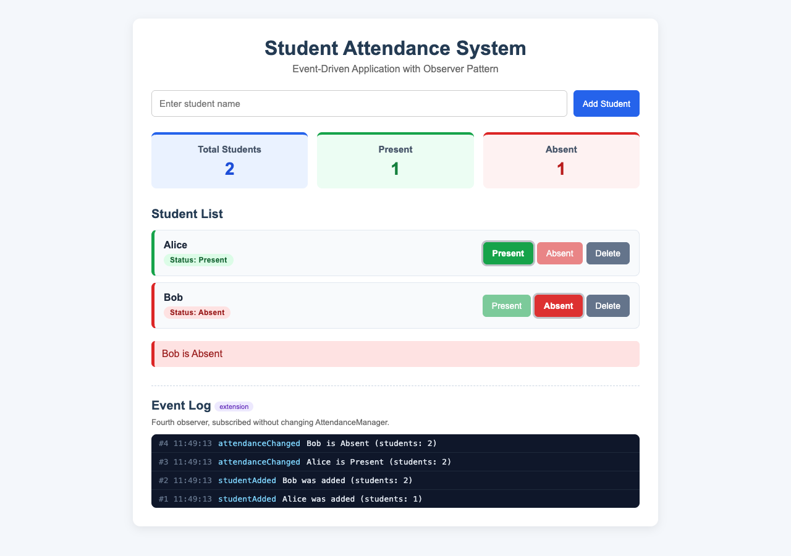
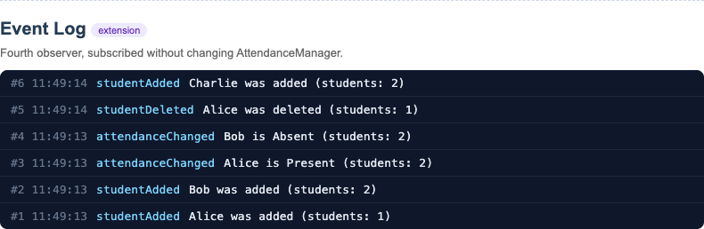

# Лабораторная работа №13: Student Attendance System — Event-Driven архитектура

**Технологии:** HTML, CSS, JavaScript (без фреймворков, без сервера, без базы данных)
**Паттерн:** Observer (Наблюдатель) + Event-Driven Architecture

---

## 1. О проекте

Student Attendance System — небольшое веб-приложение для учёта посещаемости студентов.
Преподаватель добавляет студентов, отмечает их как **Present** (пришёл) или **Absent**
(отсутствует) и удаляет из списка. Статистика, список и уведомления обновляются
**автоматически** — через паттерн Observer.

| Функция | Как работает |
|---|---|
| Список студентов | показывается под статистикой, у каждого — цветной бейдж статуса |
| Добавление студента | поле ввода + кнопка **Add Student** или клавиша **Enter** |
| Present / Absent | меняет статус студента; кнопка текущего статуса подсвечена |
| Удаление | кнопка **Delete** |
| Статистика | счётчики Total / Present / Absent пересчитываются сами |
| Уведомление | сообщение после каждого изменения, через ~3 секунды плавно исчезает |
| Журнал событий *(расширение)* | четвёртый наблюдатель `EventLogDisplay`, показывает все события |

Статусы студента: **Pending** (жёлтый, ещё не отмечен), **Present** (зелёный), **Absent** (красный).

## 2. Структура проекта

```
lab13-observer-attendance/
├── README.md       этот отчёт
├── index.html      структура страницы: поле ввода, статистика, список, уведомление, журнал
├── style.css       стили: карточки, бейджи статусов, анимация уведомления, адаптивность
├── script.js       Subject (AttendanceManager), наблюдатели и обработчики событий
├── .gitignore      исключает .DS_Store
└── screenshots/    скриншоты тестирования
```

Весь JavaScript — в **одном** файле `script.js`, части A → B → C → D → E идут строго в
порядке задания. Расширение `EventLogDisplay` стоит между частью D и частью E и помечено
комментарием `EXTENSION`.

## 3. Как запустить

Установка и сервер не нужны — достаточно открыть `index.html` в браузере:

```bash
open ~/Desktop/"Design Pattern/lab13-observer-attendance/index.html"
```

Или двойной щелчок по `index.html` в Finder. Сообщения `Event received: ...` видны в консоли
браузера (`Cmd + Option + J` в Chrome).

> Данные хранятся только в памяти страницы: после обновления страницы список пустой.
> Так и задумано в задании (нет базы данных).

## 4. Event-Driven архитектура

**Event-Driven (событийно-ориентированное) приложение** не выполняет код «сверху вниз один
раз», а **ждёт событий** и реагирует на них. Событие — это любое происшествие: щелчок по
кнопке, нажатие клавиши, изменение данных.

В проекте два уровня событий:

1. **События браузера (DOM-события)** — `click` по кнопкам, `keydown` (Enter) в поле ввода.
   Их ловят `addEventListener(...)`.
2. **События приложения** — объекты `{ type, message }`, которые `AttendanceManager`
   рассылает наблюдателям: `studentAdded`, `attendanceChanged`, `studentDeleted`.

```
Щелчок по кнопке "Present"
        │   (DOM-событие click)
        ▼
addEventListener-обработчик
        │
        ▼
attendanceManager.markAttendance(id, "Present")      ← меняет данные
        │
        ▼
attendanceManager.notify({ type: "attendanceChanged", message: "Alice is Present" })
        │
        ├──► StatisticsDisplay.update()    → пересчитывает Total / Present / Absent
        ├──► NotificationDisplay.update()  → показывает "Alice is Present"
        ├──► StudentListDisplay.update()   → перерисовывает список и бейджи
        └──► EventLogDisplay.update()      → добавляет строку в журнал (расширение)
```

## 5. Паттерн Observer (Наблюдатель)

**Суть:** один объект (*Subject*) хранит состояние и список подписчиков (*Observers*).
Когда состояние меняется, Subject сам оповещает всех подписчиков, а они обновляются.

**Аналогия:** подписка на YouTube-канал. Канал не знает, что каждый зритель будет делать
с новым видео, — он просто рассылает уведомление всем подписчикам. Подписаться или
отписаться можно в любой момент, канал при этом не меняется.

**Роли в проекте:**

| Роль | Класс / объект | За что отвечает |
|---|---|---|
| Subject (издатель) | `AttendanceManager` | хранит `students`, список `observers`; методы `subscribe`, `unsubscribe`, `notify`, `addStudent`, `markAttendance`, `deleteStudent` |
| Observer 1 | `StatisticsDisplay` | счётчики Total / Present / Absent |
| Observer 2 | `NotificationDisplay` | уведомление на экране + `console.log` |
| Observer 3 | `StudentListDisplay` | список студентов с кнопками |
| Observer 4 *(расширение)* | `EventLogDisplay` | журнал событий |
| Event (событие) | объект `{ type, message }` | `studentAdded`, `attendanceChanged`, `studentDeleted` |
| Интерфейс наблюдателя | метод `update(students, event)` | его обязан иметь каждый наблюдатель |

**Подписка и оповещение (Subject):**

```javascript
class AttendanceManager {
    constructor() {
        this.students = [];
        this.observers = [];
        this.nextId = 1;
    }

    subscribe(observer) {                // зарегистрировать наблюдателя
        this.observers.push(observer);
    }

    unsubscribe(observer) {              // расширение: отписать наблюдателя
        this.observers = this.observers.filter(o => o !== observer);
    }

    notify(event) {                      // оповестить всех
        this.observers.forEach(observer => {
            observer.update(this.students, event);
        });
    }

    markAttendance(id, status) {
        const student = this.students.find(s => s.id === id);
        if (student) {
            student.status = status;
            this.notify({
                type: "attendanceChanged",
                message: student.name + " is " + status
            });
        }
    }
    // addStudent() и deleteStudent() устроены так же: изменить данные → notify()
}
```

**Наблюдатель (метод `update`):**

```javascript
class StatisticsDisplay {
    update(students, event) {
        const total   = students.length;
        const present = students.filter(s => s.status === "Present").length;
        const absent  = students.filter(s => s.status === "Absent").length;

        document.getElementById("totalCount").textContent   = total;
        document.getElementById("presentCount").textContent = present;
        document.getElementById("absentCount").textContent  = absent;
    }
}
```

**Связывание (часть E):**

```javascript
const attendanceManager = new AttendanceManager();

attendanceManager.subscribe(new StatisticsDisplay());
attendanceManager.subscribe(new NotificationDisplay());
attendanceManager.subscribe(new StudentListDisplay());

// расширение — AttendanceManager при этом НЕ изменяется
attendanceManager.subscribe(new EventLogDisplay());
```

**Безопасность:** имя студента везде выводится через `textContent`, а не `innerHTML`.
Если ввести ``, на странице появится именно этот текст, а не
картинка со скриптом (проверено, см. раздел 8).

**Исправление ошибки из задания:** в PDF в обработчике кнопки стоит

```javascript
if (name === "") {
    return;
    alert("Please enter a student name");   // недостижимый код — alert никогда не покажется
}
```

Из-за этого тест 6 («Warning message appears») не проходил бы. В `script.js` порядок
исправлен: сначала `alert(...)`, потом `return`.

## 6. Что происходит при нажатии Present

Пример: `attendanceManager.markAttendance(1, "Present")`.

1. Браузер генерирует DOM-событие `click` на кнопке **Present**.
2. Срабатывает обработчик, который `StudentListDisplay` повесил на эту кнопку, и вызывает
   `attendanceManager.markAttendance(student.id, "Present")`.
3. `AttendanceManager` находит студента по `id` (`students.find(...)`).
4. Статус студента меняется на `"Present"`.
5. `AttendanceManager` вызывает `notify({ type: "attendanceChanged", message: "Alice is Present" })`.
6. `StatisticsDisplay.update()` пересчитывает счётчики — Present становится 1.
7. `NotificationDisplay.update()` показывает «Alice is Present» и пишет в консоль
   `Event received: attendanceChanged Alice is Present`; через ~3 с уведомление исчезает.
8. `StudentListDisplay.update()` перерисовывает список: зелёный бейдж «Status: Present»,
   подсвеченная кнопка Present, зелёная полоса слева.
9. `EventLogDisplay.update()` добавляет строку в журнал событий (расширение).

Subject **не вызывает** ни одну из этих display-классов по имени — он знает только, что у
каждого наблюдателя есть метод `update()`.

## 7. Traditional Approach vs Observer

| Традиционный подход | Паттерн Observer |
|---|---|
| Менеджер сам обновляет каждый элемент страницы (`updateStats(); updateList(); showMessage();`) | Менеджер вызывает один `notify()`, а наблюдатели обновляются сами |
| Компоненты жёстко связаны (tight coupling) | Компоненты слабо связаны (loose coupling) |
| Новый элемент интерфейса → нужно менять код менеджера | Новый наблюдатель → просто `subscribe()`, менеджер не меняется |
| Сложнее расширять и тестировать | Легко расширять, каждый наблюдатель можно проверить отдельно |
| Нельзя отключить часть обновлений во время работы | Можно `unsubscribe()` в любой момент |

## 8. Тестирование

Тесты выполнены автоматически в Chrome (headless, puppeteer): скрипт вводит имена, нажимает
кнопки, перехватывает `alert` и проверяет счётчики на странице.

| № | Действие | Ожидаемый результат | Фактический результат | Итог |
|---|---|---|---|---|
| 1 | Добавить Alice | Alice появилась в списке | список: `["Alice"]` | PASS |
| 2 | Добавить Bob | Total Students = 2 | Total = 2 | PASS |
| 3 | Alice → Present | Present = 1 | Present = 1 | PASS |
| 4 | Bob → Absent | Absent = 1 | Absent = 1 | PASS |
| 5 | Удалить Alice | Total Students = 1 | Total = 1, список: `["Bob"]` | PASS |
| 6 | Пустое имя (пробелы) | Появляется предупреждение | `alert("Please enter a student name")`, Total остался 1 | PASS |
| 7 | Ввести «Charlie» и нажать Enter | Студент добавлен | список: `["Bob", "Charlie"]`, Total = 2, поле очищено | PASS |

Дополнительно проверено: имя `` выводится как текст (на странице
0 элементов ``); уведомление скрывается примерно через 3 секунды; ошибок JavaScript
в консоли нет.

Сообщения в консоли браузера во время теста:

```
Event received: studentAdded Alice was added
Event received: studentAdded Bob was added
Event received: attendanceChanged Alice is Present
Event received: attendanceChanged Bob is Absent
Event received: studentDeleted Alice was deleted
Event received: studentAdded Charlie was added
```





Все скриншоты лежат в папке `screenshots/`.

| № | Файл | Что показано |
|---|---|---|
| 1 | [01_empty.png](screenshots/01_empty.png) | Пустое приложение: счётчики 0, «No students yet» |
| 2 | [02_students_added.png](screenshots/02_students_added.png) | Тесты 1–2: Alice и Bob добавлены (статус Pending), Total = 2 |
| 3 | [03_alice_present.png](screenshots/03_alice_present.png) | Тест 3: Alice — Present, Present = 1, уведомление «Alice is Present» |
| 4 | [04_bob_absent.png](screenshots/04_bob_absent.png) | Тест 4: Bob — Absent, Absent = 1, красное уведомление |
| 5 | [05_alice_deleted.png](screenshots/05_alice_deleted.png) | Тест 5: Alice удалена, Total = 1 |
| 6 | [06_empty_name_warning.png](screenshots/06_empty_name_warning.png) | Тест 6: страница сразу после закрытия `alert` «Please enter a student name» — ничего не добавлено, Total = 1 (системное окно `alert` на скриншот не попадает) |
| 7 | [07_enter_key.png](screenshots/07_enter_key.png) | Тест 7: Charlie добавлен клавишей Enter |
| 8 | [08_console_events.png](screenshots/08_console_events.png) | Журнал событий (наблюдатель `EventLogDisplay`) — те же события, что и в консоли |

## 9. Ответы на контрольные вопросы

1. **Что такое Event-Driven приложение?** Это программа, которая работает в ответ на
   события: щелчки, нажатия клавиш, изменение данных. Код не идёт линейно, а ждёт событие
   и запускает соответствующий обработчик. Здесь: щелчок по Present → статус меняется →
   статистика и уведомление обновляются.
2. **Что такое паттерн Observer?** Поведенческий паттерн: объект-*Subject* хранит список
   наблюдателей и при изменении своего состояния автоматически оповещает их всех через
   общий метод (`update`). Связь «один ко многим», при этом Subject не знает конкретных
   классов наблюдателей.
3. **Какой класс — Subject?** `AttendanceManager`: хранит массив студентов и список
   наблюдателей, меняет данные и вызывает `notify()`.
4. **Какие классы — Observers?** `StatisticsDisplay`, `NotificationDisplay`,
   `StudentListDisplay` (по заданию) и `EventLogDisplay` (расширение). У всех есть метод
   `update(students, event)`.
5. **Что происходит при нажатии Present?** Обработчик `click` вызывает
   `markAttendance(id, "Present")` → менеджер находит студента и меняет статус → вызывает
   `notify()` → каждый наблюдатель получает `update()`: счётчики пересчитываются, появляется
   уведомление, список перерисовывается (подробно — раздел 6).
6. **Зачем нужен метод `notify()`?** Это единая точка оповещения: после любого изменения
   данных менеджер вызывает только `notify(event)`, а тот передаёт актуальные данные и
   описание события всем подписчикам. Менеджеру не нужно знать, кто и как отображает данные.
7. **Зачем нужен метод `subscribe()`?** Он регистрирует наблюдателя — добавляет его в
   массив `observers`. Только подписанные объекты получают обновления. Так набор
   наблюдателей можно менять без изменения кода менеджера.
8. **Чем DOM event listener отличается от Observer?** `addEventListener` — встроенный в
   браузер механизм для событий **элементов страницы** (`click`, `keydown`); источник —
   DOM-элемент, события генерирует браузер. Observer — **наш собственный** паттерн уровня
   приложения: источник — `AttendanceManager`, события (`studentAdded` и т. д.) описывают
   изменения **данных**. По сути, DOM-события — тоже реализация идеи Observer, но в проекте
   они работают на разных уровнях: listener ловит действие пользователя и вызывает метод
   менеджера, а Observer разносит результат по всем частям интерфейса.
9. **Что будет, если убрать наблюдатель `StatisticsDisplay`?** Приложение продолжит
   работать: студенты добавляются, список и уведомления обновляются. Перестанут меняться
   только счётчики Total / Present / Absent — они останутся с последними значениями (или 0).
   Ошибок не будет, потому что менеджер просто перебирает тех, кто есть в списке. Сделать это
   можно, не подписывая его или вызвав `attendanceManager.unsubscribe(statisticsObserver)`.
10. **Как добавить нового наблюдателя, не меняя `AttendanceManager`?** Создать класс с
    методом `update(students, event)` и подписать его: `attendanceManager.subscribe(new X())`.
    Именно так в проект добавлен `EventLogDisplay` — журнал событий. В `AttendanceManager`
    не изменено ни строчки (принцип открытости/закрытости, Open/Closed Principle).

## 10. Критерии оценивания

| Критерий | Баллы | Где выполнено |
|---|---|---|
| HTML structure and interface | 10 | ☑ `index.html`: все id из задания (`studentName`, `addStudentBtn`, `totalCount`, `presentCount`, `absentCount`, `studentList`, `notification`) |
| CSS styling | 10 | ☑ `style.css`: стили из задания + цветные бейджи статусов, подсветка текущего статуса, затухание уведомления, адаптивность `@media (max-width: 600px)` |
| Event handling | 15 | ☑ `click` на Add / Present / Absent / Delete, `keydown` Enter, предупреждение при пустом имени |
| Subject implementation | 20 | ☑ `AttendanceManager`: `subscribe`, `notify`, `addStudent`, `markAttendance`, `deleteStudent` (+ `unsubscribe`) |
| Observer implementation | 20 | ☑ `StatisticsDisplay`, `NotificationDisplay`, `StudentListDisplay` с методом `update()` (+ `EventLogDisplay`) |
| Attendance management | 15 | ☑ добавление, Present / Absent, удаление, автоматическая статистика |
| Testing and explanation | 10 | ☑ 7 тестов — все PASS, скриншоты, ответы на 10 вопросов |
| **Итого** | **100** | |
